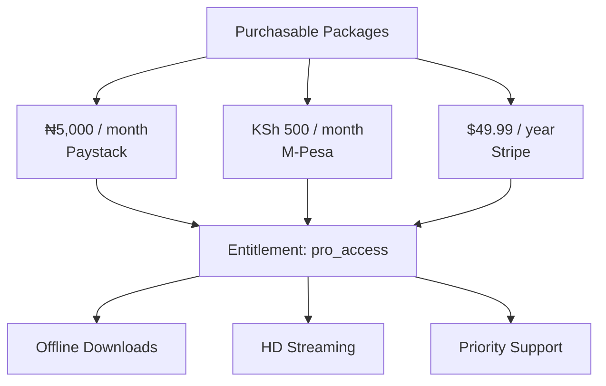

import Tabs from '@theme/Tabs';
import TabItem from '@theme/TabItem';

# Entitlements Architecture

An **Entitlement** represents a specific permission level or feature access unlocked within your application (e.g., `pro_access`, `hd_streaming`, `export_reports`).

Instead of writing complex conditionals that inspect payment IDs, currencies, or gateway transaction states, your application only checks whether the customer possesses an active Entitlement.



---

## Why Entitlements Matter

Payment states in emerging markets are dynamic (e.g., *Pending USSD settlement*, *Orphaned transaction recovery*, *Chargeback reversal*, *Subscription grace period*). 

Your app code should never attempt to evaluate raw financial states. SolydFlow abstracts these into a single boolean access state:

| Bad / Anti-Pattern ❌ | SolydFlow Recommended Pattern ✅ |
| :--- | :--- |
| `if (response.status == 'success')` | `if (await SolydFlow.hasEntitlement("pro_access"))` |
| `if (user.paid_via_paystack && !user.is_expired)` | `if (customerInfo.activeEntitlements["pro_access"])` |
| `if (order.amount == 5000 && order.currency == 'NGN')` | Insulated from all currencies and price changes. |

---

## Checking Entitlements in Code

### 1. Fast Access Check (`<5ms` Offline-First)

Use `hasEntitlement()` for UI routing, tab rendering, and instant feature gating. This call reads from the device's hardware-encrypted local store:

<Tabs>
<TabItem value="flutter" label="Flutter" default>

```dart title="lib/screens/dashboard.dart"
import 'package:flutter/material.dart';
import 'package:solydflow_flutter/solydflow_flutter.dart';

Future<void> onFeatureTapped(BuildContext context) async {
  // Ultra-fast check (<5ms)
  final bool isPro = await SolydFlow.hasEntitlement("pro_access");

  if (isPro) {
    Navigator.pushNamed(context, "/pro-export-tool");
  } else {
    Navigator.pushNamed(context, "/paywall");
  }
}
```

</TabItem>
<TabItem value="javascript" label="JavaScript / TypeScript (Web)">

```typescript title="src/guards/authGuard.ts"
import { SolydFlow } from "solydflow-js";

export async function canAccessProDashboard(): Promise<boolean> {
  return await SolydFlow.hasEntitlement("pro_access");
}
```

</TabItem>
</Tabs>

---

### 2. Deep Customer State & Expiry Dates

When displaying subscription management settings, account profile details, or expiration warnings, query `getCustomerInfo()`:

<Tabs>
<TabItem value="flutter" label="Flutter (Subscription Info Screen)" default>

```dart title="lib/screens/account_screen.dart"
import 'package:flutter/material.dart';
import 'package:solydflow_flutter/solydflow_flutter.dart';

Future<void> loadSubscriptionDetails() async {
  final CustomerInfo info = await SolydFlow.getCustomerInfo();

  // 1. Boolean check
  final bool hasPro = info.activeEntitlements["pro_access"] ?? false;

  // 2. Expiration timestamp
  final DateTime? expiresAt = info.allEntitlements["pro_access"];

  if (hasPro && expiresAt != null) {
    debugPrint("Pro active until: ${expiresAt.toIso8601String()}");
  } else {
    debugPrint("No active pro subscription");
  }
}
```

</TabItem>
<TabItem value="javascript" label="JavaScript / TypeScript (Web)">

```typescript title="src/account.ts"
import { SolydFlow } from "solydflow-js";

async function checkExpiration() {
  const customerInfo = await SolydFlow.getCustomerInfo();
  
  if (customerInfo.active_entitlements["pro_access"]) {
    const expiry = customerInfo.all_entitlements["pro_access"];
    console.log(`Access valid until: ${new Date(expiry).toLocaleDateString()}`);
  }
}
```

</TabItem>
</Tabs>

---

## Reusable UI Gating Pattern (Flutter)

Create an `EntitlementGate` widget to keep your widget tree clean and declarative:

```dart title="lib/widgets/entitlement_gate.dart"
import 'package:flutter/material.dart';
import 'package:solydflow_flutter/solydflow_flutter.dart';

class EntitlementGate extends StatelessWidget {
  final String entitlement;
  final Widget child;
  final Widget fallback;

  const EntitlementGate({
    super.key,
    required this.entitlement,
    required this.child,
    this.fallback = const SizedBox.shrink(),
  });

  @override
  Widget build(BuildContext context) {
    return FutureBuilder<bool>(
      future: SolydFlow.hasEntitlement(entitlement),
      builder: (context, snapshot) {
        if (snapshot.connectionState == ConnectionState.waiting) {
          return const Center(child: CircularProgressIndicator());
        }
        final hasAccess = snapshot.data ?? false;
        return hasAccess ? child : fallback;
      },
    );
  }
}

// Usage in your UI:
// EntitlementGate(
//   entitlement: "pro_access",
//   child: ProAnalyticsWidget(),
//   fallback: UpgradeBannerWidget(),
// )
```

---

## Entitlement Naming Best Practices

Define names that describe **functional capabilities** rather than payment rails:

| ✅ Recommended Entitlement IDs | ❌ Anti-Patterns to Avoid |
| :--- | :--- |
| `pro_access` | `paystack_subscription` *(Coupled to provider)* |
| `offline_downloads` | `ngn_5000_plan` *(Coupled to currency/price)* |
| `school_admin_suite` | `monthly_card_plan` *(Coupled to billing interval)* |
| `ai_tokens_500` | `flutterwave_charge` *(Coupled to payment method)* |

---

## Related Documentation

* **[Transactions & Consensus Ledger →](./transactions.md)**
* **[Transaction States Lifecycle →](./transaction-states.md)**
* **[Truth & Consensus Engine →](../truth/overview.md)**
* **[Enforce & Feature Delivery →](../enforce/overview.md)**
