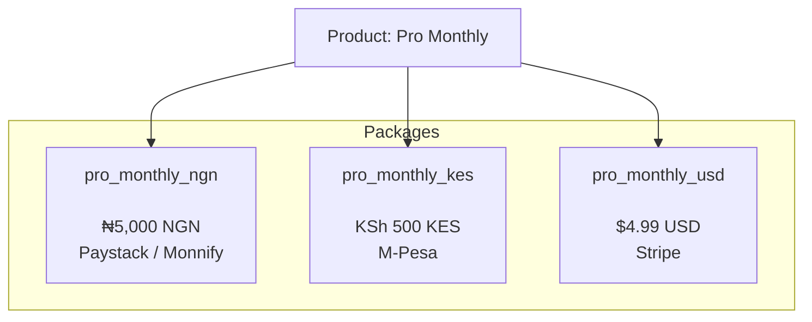
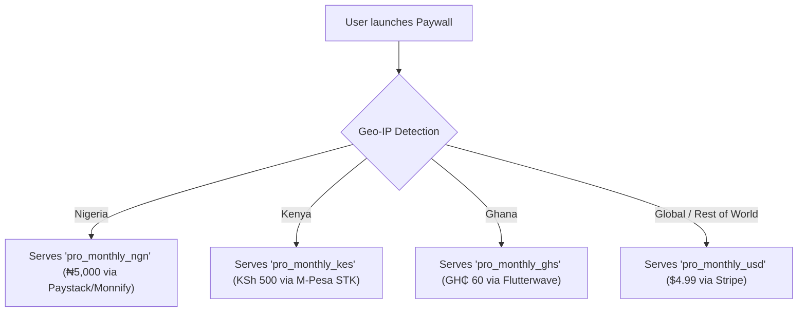

import Tabs from '@theme/Tabs';
import TabItem from '@theme/TabItem';

# Packages

A **Package** is the technical, purchasable unit in SolydFlow. While a **Product** defines your high-level offering, every transaction processed by the SDK, hosted checkout, or API is executed against a specific Package.

A Package supports **one currency only**. To sell the same Product across multiple countries or app stores, you configure multiple Packages under the same Product.



---

## Package Data Model & Fields

When you fetch packages via the SDK, SolydFlow returns `SolydPackage` objects containing:

| Field | Type | Description |
| :--- | :--- | :--- |
| `identifier` | `String` | Unique SDK slug (e.g., `pro_monthly_ngn`, `pro_yearly_usd`). |
| `name` | `String` | Display title inherited from Product (e.g., *Pro Monthly*). |
| `currency` | `String` | ISO currency code (`NGN`, `KES`, `GHS`, `ZAR`, `USD`, `EUR`). |
| `amountMinor` | `int` | Base price in the smallest currency unit (kobo/cents). |
| `isUpgrade` | `bool` | `true` if customer has an active lower tier eligible for pro-rated credit. |
| `calculatedAmountMinor` | `int` | Pro-rated upgrade price if `isUpgrade == true`. |
| `duration` | `String` | Billing period (`P1M`, `P1Y`, `P1W`, or `lifetime`). |
| `appleProductId` | `String?` | *(Optional)* StoreKit Product ID (e.g., `com.app.pro.monthly`). |
| `googleProductId` | `String?` | *(Optional)* Google Play In-App Product ID. |

---

## Working with Packages in Code

### 1. Fetching & Inspecting Packages

When fetching offerings, inspect `isUpgrade` to display upgrade credits dynamically:

<Tabs>
<TabItem value="flutter" label="Flutter" default>

```dart title="lib/screens/pricing_screen.dart"
import 'package:flutter/material.dart';
import 'package:solydflow_flutter/solydflow_flutter.dart';

Future<void> displayOfferings() async {
  List<SolydPackage> packages = await SolydFlow.getOfferings();

  for (var pkg in packages) {
    if (pkg.isUpgrade) {
      final double upgradePrice = pkg.calculatedAmountMinor;
      debugPrint("Upgrade to ${pkg.name} for ${pkg.currency} $upgradePrice");
    } else {
      final double standardPrice = pkg.amountMinor;
      debugPrint("${pkg.name}: ${pkg.currency} $standardPrice / ${pkg.duration}");
    }
  }
}
```

</TabItem>
<TabItem value="javascript" label="JavaScript / TypeScript (Web)">

```typescript title="src/offerings.ts"
import { SolydFlow } from "solydflow-js";

async function logOfferings() {
  const offerings = await SolydFlow.getOfferings();

  offerings.forEach((pkg) => {
    const price = pkg.is_upgrade
      ? pkg.calculated_amount_minor
      : pkg.amount_minor;

    console.log(
      `${pkg.name} [${pkg.identifier}]: ${pkg.currency} ${price}` +
      (pkg.is_upgrade ? " (Upgrade Credit Applied)" : "")
    );
  });
}
```

</TabItem>
</Tabs>

---

### 2. Purchasing a Specific Package

Pass the chosen package identifier directly to `purchasePackage`:

<Tabs>
<TabItem value="flutter" label="Flutter" default>

```dart title="lib/screens/checkout.dart"
Future<void> checkoutPackage(BuildContext context, String packageId) async {
  try {
    final CustomerInfo? info = await SolydFlow.purchasePackage(
      context,
      packageId, // e.g., "pro_monthly_ngn"
    );

    if (info?.activeEntitlements["pro_access"] == true) {
      debugPrint("Access granted via package: $packageId");
    }
  } catch (e) {
    debugPrint("Purchase failed: $e");
  }
}
```

</TabItem>
<TabItem value="javascript" label="JavaScript / TypeScript (Web)">

```typescript title="src/checkout.ts"
import { SolydFlow } from "solydflow-js";

async function buyWebPackage(packageId: string) {
  // Redirects to Smart-Routed hosted checkout
  await SolydFlow.purchasePackage(packageId, "+2348012345678");
}
```

</TabItem>
</Tabs>

---

## Automatic Geo-IP Package Resolution

When your frontend requests offerings without specifying a package ID, SolydFlow's **Smart Payment Router** automatically resolves the customer's country via IP and serves the most relevant regional Package:



If a customer is outside your defined currency markets, SolydFlow automatically falls back to your base currency package (typically USD).

---

## Related Documentation

* **[Products & Offerings →](./products.md)**
* **[Regional Pricing & PPP →](./pricing.md)**
* **[Entitlements Architecture →](./entitlements.md)**
* **[Smart Payment Routing →](../enforce/smart-routing.md)**
