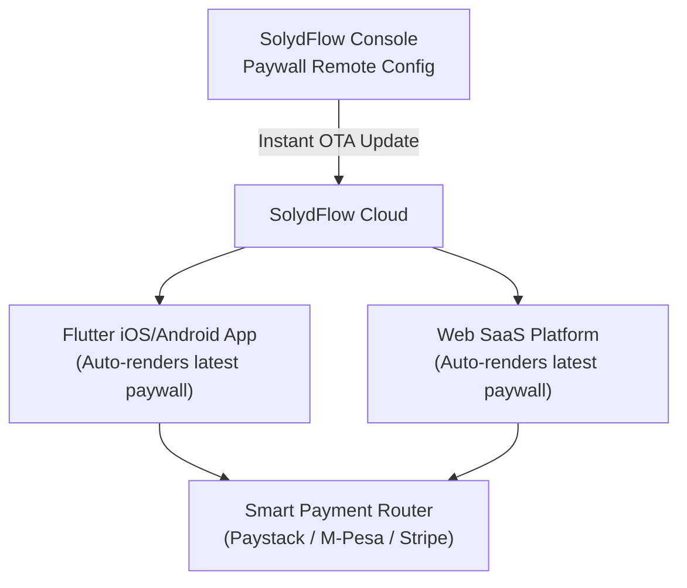

import Tabs from '@theme/Tabs';
import TabItem from '@theme/TabItem';

# Paywalls & Checkout UI

A **Paywall** is the customer-facing interface where users discover premium offerings, compare subscription tiers, and complete purchases.

SolydFlow decouples paywall presentation from core application logic. This allows product teams to adjust pricing, launch seasonal promotions, or test copy from the SolydFlow Console without submitting new builds to the Apple App Store or Google Play Store.



---

## Choosing Your Paywall Strategy

| Feature | No-Code Drop-In Paywall | Custom UI Paywall |
| :--- | :--- | :--- |
| **Best For** | Fast implementation, rapid experimentation, non-technical updates. | Bespoke design systems, custom animations, tightly integrated brand flows. |
| **Managed From** | SolydFlow Console (Drag-and-drop designer). | Your application codebase (Flutter widgets, React components). |
| **OTA Updates** | **Instant.** Copy, colors, and tier order update without app releases. | Requires app update if changing layout/widgets. |
| **Localization & PPP** | Handled automatically by the SDK. | Handled via SDK data attributes (`pkg.currency`, `amountMinor`). |

---

## Option A: No-Code Drop-In Paywall

The fastest way to monetize. SolydFlow renders a high-converting, responsive paywall synchronized with your Console settings.

<Tabs>
<TabItem value="flutter" label="Flutter (SolydPaywall Modal)" default>

```dart title="lib/screens/home_screen.dart"
import 'package:flutter/material.dart';
import 'package:solydflow_flutter/solydflow_flutter.dart';

void launchPaywall(BuildContext context) {
  showModalBottomSheet(
    context: context,
    isScrollControlled: true,
    backgroundColor: Colors.transparent,
    builder: (ctx) => SolydPaywall(
      onPurchaseSuccess: (CustomerInfo info) {
        Navigator.pop(ctx);
        ScaffoldMessenger.of(ctx).showSnackBar(
          const SnackBar(content: Text("🚀 Subscription Active!")),
        );
      },
      onClose: () => Navigator.pop(ctx),
    ),
  );
}
```

</TabItem>
<TabItem value="web" label="JavaScript / TypeScript (Container Render)">

```html title="pricing.html"
<div id="solydflow-paywall-container"></div>

<script type="module">
  import { SolydFlow } from "solydflow-js";

  await SolydFlow.configure(
    "sf_pk_live_44019283bc918237fa",
    "usr_db_99182",
    "customer@example.com"
  );

  // Renders the dashboard-configured paywall into the target DOM element
  await SolydFlow.renderWebPaywall("solydflow-paywall-container");
</script>
```

</TabItem>
</Tabs>

---

## Option B: Custom UI Paywall

If your app requires a custom design system, fetch the raw offerings from SolydFlow and bind them to your own widgets.

<Tabs>
<TabItem value="flutter" label="Flutter (Custom Paywall Widget)" default>

```dart title="lib/screens/custom_paywall.dart"
import 'package:flutter/material.dart';
import 'package:solydflow_flutter/solydflow_flutter.dart';

class CustomPaywall extends StatefulWidget {
  const CustomPaywall({super.key});

  @override
  State<CustomPaywall> createState() => _CustomPaywallState();
}

class _CustomPaywallState extends State<CustomPaywall> {
  List<SolydPackage> _packages = [];
  bool _loading = true;
  String? _activePackageId;

  @override
  void initState() {
    super.initState();
    _loadOfferings();
  }

  Future<void> _loadOfferings() async {
    try {
      final offerings = await SolydFlow.getOfferings();
      setState(() {
        _packages = offerings;
        _loading = false;
      });
    } catch (e) {
      setState(() => _loading = false);
    }
  }

  Future<void> _handleBuy(String packageId) async {
    setState(() => _activePackageId = packageId);
    try {
      final info = await SolydFlow.purchasePackage(context, packageId);
      if (info?.activeEntitlements["pro_access"] == true && mounted) {
        Navigator.pop(context);
      }
    } finally {
      if (mounted) setState(() => _activePackageId = null);
    }
  }

  @override
  Widget build(BuildContext context) {
    if (_loading) return const Center(child: CircularProgressIndicator());

    return Scaffold(
      appBar: AppBar(title: const Text("Unlock Pro")),
      body: ListView(
        padding: const EdgeInsets.all(16),
        children: [
          const Text("🔥 Pro Features", style: TextStyle(fontSize: 20, fontWeight: FontWeight.bold)),
          const ListTile(leading: Icon(Icons.check), title: Text("Unlimited HD Downloads")),
          const ListTile(leading: Icon(Icons.check), title: Text("Offline Reading Mode")),
          const Divider(height: 32),
          ..._packages.map((pkg) {
            final double price = (pkg.isUpgrade ? pkg.calculatedAmountMinor : pkg.amountMinor);
            final isBuying = _activePackageId == pkg.identifier;

            return Card(
              margin: const EdgeInsets.only(bottom: 12),
              child: ListTile(
                title: Text(pkg.name, style: const TextStyle(fontWeight: FontWeight.bold)),
                subtitle: Text("${pkg.currency} $price / ${pkg.duration}"),
                trailing: isBuying
                    ? const CircularProgressIndicator()
                    : ElevatedButton(
                        onPressed: _activePackageId == null ? () => _handleBuy(pkg.identifier) : null,
                        child: const Text("Subscribe"),
                      ),
              ),
            );
          }),
        ],
      ),
    );
  }
}
```

</TabItem>
<TabItem value="javascript" label="React / Next.js Component">

```tsx title="components/CustomPaywall.tsx"
import React, { useEffect, useState } from "react";
import { SolydFlow, SolydPackage } from "solydflow-js";

export function CustomPaywall() {
  const [packages, setPackages] = useState<SolydPackage[]>([]);
  const [loading, setLoading] = useState(true);

  useEffect(() => {
    async function fetchOfferings() {
      const data = await SolydFlow.getOfferings();
      setPackages(data);
      setLoading(false);
    }
    fetchOfferings();
  }, []);

  const handleCheckout = async (packageId: string) => {
    await SolydFlow.purchasePackage(packageId, "+2348012345678");
  };

  if (loading) return <div>Loading offerings...</div>;

  return (
    <div className="grid grid-cols-1 md:grid-cols-2 gap-4">
      {packages.map((pkg) => (
        <div key={pkg.identifier} className="border p-6 rounded-lg">
          <h3 className="text-xl font-bold">{pkg.name}</h3>
          <p className="text-2xl my-2">
            {pkg.currency} {pkg.amount_minor}
          </p>
          <button
            onClick={() => handleCheckout(pkg.identifier)}
            className="w-full bg-blue-600 text-white py-2 rounded"
          >
            Upgrade Now
          </button>
        </div>
      ))}
    </div>
  );
}
```

</TabItem>
</Tabs>

---

## Related Documentation

* **[Products & Offerings Catalog →](./products.md)**
* **[Packages & Currency Units →](./packages.md)**
* **[Pricing & Purchasing Power Parity →](./pricing.md)**
* **[Entitlements Architecture →](./entitlements.md)**