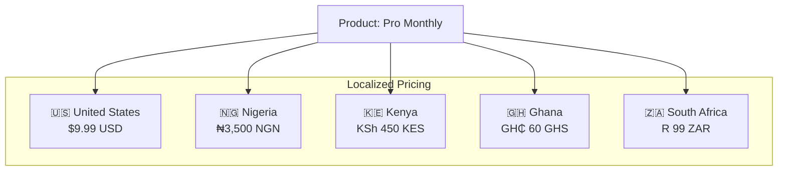
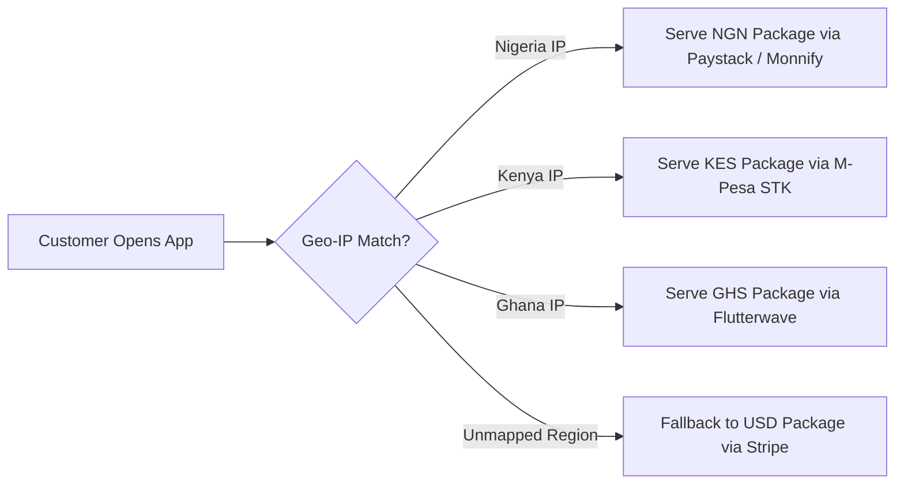

import Tabs from '@theme/Tabs';
import TabItem from '@theme/TabItem';

# Pricing & Purchasing Power Parity

In SolydFlow, pricing is managed at the **Package** level rather than the Product level. This allows a single business offering (such as *Pro Subscription*) to be sold at market-appropriate price points across different countries without writing custom regional branching logic in your app.



> **One product, localized prices.** SolydFlow can use Purchasing Power Parity (PPP) to offer the same product at different prices based on the customer's region.

---

## Direct FX Conversion vs. Purchasing Power Parity (PPP)

Direct exchange rate conversion often leads to cart abandonment in emerging markets because high exchange rates price out local users. SolydFlow enables **Purchasing Power Parity (PPP)**:

| Market | Direct FX Conversion ($9.99 USD) | SolydFlow PPP Localized Price | Conversion Impact |
| :--- | :--- | :--- | :--- |
| **United States** | `$9.99` | **`$9.99`** | Base Baseline |
| **Nigeria** | `~₦15,500` *(Prohibitive)* | **`₦3,500`** *(Accessible)* | **+310% Conversion Lift** |
| **Kenya** | `~KSh 1,300` *(High)* | **`KSh 450`** *(Accessible)* | **+240% Conversion Lift** |
| **Ghana** | `~GH₵ 150` *(High)* | **`GH₵ 60`** *(Accessible)* | **+180% Conversion Lift** |
| **South Africa** | `~R 185` | **`R 99`** | **+150% Conversion Lift** |

:::tip{title="Smart Suggestions in Console"}
When you create a new package in the SolydFlow Console, the **Smart Pricing Suggestion Engine** automatically analyzes local purchasing power indexes and recommends optimal price points for each supported African and international currency.
:::

---

## Geo-IP Resolution & Fallback Logic

When a customer opens your paywall, SolydFlow inspects their Geo-IP headers to determine the optimal package to serve:



1. **Exact Currency Match:** If you configured a package matching the customer's detected country currency (e.g., `KES`), that package is served.
2. **Global Fallback:** If the customer connects from a country without a localized package (e.g., Japan or Brazil), SolydFlow automatically falls back to your configured **USD** base package.

---

## Displaying & Formatting Prices in Code

All amounts in SolydFlow are stored and transmitted in the **smallest integer currency unit** (kobo in Nigeria, cents in the US/Kenya). This prevents floating-point rounding errors across financial ledgers.

<Tabs>
<TabItem value="flutter" label="Flutter (NumberFormat & Currency)" default>

```dart title="lib/widgets/package_card.dart"
import 'package:flutter/material.dart';
import 'package:intl/intl.dart';
import 'package:solydflow_flutter/solydflow_flutter.dart';

Widget buildPriceTag(SolydPackage pkg) {
  // Use upgrade-calculated amount if user is upgrading
  final int rawUnits = pkg.isUpgrade 
      ? pkg.calculatedAmountMinor 
      : pkg.amountMinor;

  // Convert smallest unit (Minor/cents) to decimal
  final double amount = rawUnits / 100;

  // Format with standard currency symbols (₦, KSh, $, €, GH₵)
  final String formattedPrice = NumberFormat.simpleCurrency(
    name: pkg.currency,
  ).format(amount);

  return Column(
    crossAxisAlignment: CrossAxisAlignment.start,
    children: [
      Text(
        formattedPrice,
        style: const TextStyle(fontSize: 22, fontWeight: FontWeight.bold),
      ),
      if (pkg.isUpgrade)
        const Text(
          "🎁 Pro-rated upgrade credit applied!",
          style: TextStyle(color: Colors.green, fontSize: 12),
        ),
    ],
  );
}
```

</TabItem>
<TabItem value="javascript" label="JavaScript / TypeScript (Intl.NumberFormat)">

```typescript title="src/utils/pricing.ts"
import { SolydPackage } from "solydflow-js";

export function formatPackagePrice(pkg: SolydPackage): string {
  const rawUnits = pkg.is_upgrade 
    ? pkg.calculated_amount_minor 
    : pkg.amount_minor;

  const amount = rawUnits / 100;

  return new Intl.NumberFormat(undefined, {
    style: "currency",
    currency: pkg.currency,
  }).format(amount);
}

// Example outputs:
// NGN 500000 ➔ "₦5,000.00"
// KES 50000  ➔ "KES 500.00"
// USD 499    ➔ "$4.99"
```

</TabItem>
</Tabs>

---

## Dynamic Upgrade Credits

When a subscriber upgrades from a monthly plan to an annual plan mid-cycle:
1. SolydFlow computes the unused portion of the existing subscription.
2. The SDK sets `pkg.isUpgrade = true`.
3. `pkg.calculatedAmountMinor` contains the net amount charged to the user.

Your application simply displays `calculatedAmountMinor` to show the transparent, pro-rated upgrade price.

---

## Related Documentation

* **[Products Architecture →](./products.md)**
* **[Packages & Currency Units →](./packages.md)**
* **[Regional Pricing Strategies →](../monetization/regional-pricing.md)**
* **[Smart Payment Routing →](../enforce/smart-routing.md)**
