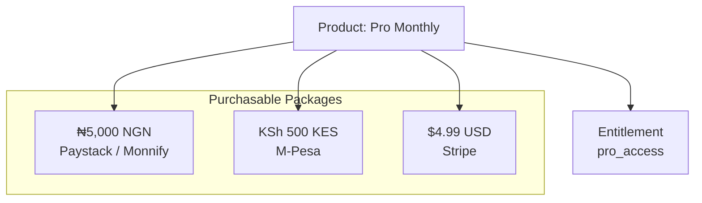

# Products

A **Product** represents a distinct business offering or tier within your application (e.g., *Pro Monthly*, *Elite Annual*, *100 AI Credits*).

Products define the shared business configuration, duration, billing cadence, and entitlement mapping for all regional purchase options beneath it.



---

## Product vs. Package vs. Entitlement

To keep monetization scalable and prevent hardcoded gateway logic, SolydFlow separates these three concepts:

| Concept | Question Answered | Example | Target Layer |
| :--- | :--- | :--- | :--- |
| **Product** | *What is the business selling?* | `Pro Subscription (Monthly)` | Business & Pricing Matrix |
| **Package** | *How is it purchased in a currency/rail?* | `pro_monthly_ngn` (₦5,000 via Paystack) | SDK Checkout & Gateway Routing |
| **Entitlement** | *What features does the user unlock?* | `pro_access` | App Code & Feature Gating |

---

## Core Product Attributes

When configuring a Product in the **SolydFlow Console (Pricing & Products)**, you define:

```text
┌─────────────────────────────────────────────────────────────┐
│ Product Configuration                                       │
├─────────────────────────────────────────────────────────────┤
│ Display Name:        [ Pro Subscription                    ]│
│ Identifier:          [ pro_monthly                         ]│
│ Product Type:        (●) Subscription   ( ) Non-Renewing   │
│ Duration / Cadence:  [ Monthly (30 Days)                  ▼]│
│ Tier Level:          [ 2                                   ]│
│ Mapped Entitlement:  [ pro_access                         ▼]│
└─────────────────────────────────────────────────────────────┘
```

### 1. Product Type
* **Subscription:** Grants continuous access with recurring or manual cycle renewals (e.g., monthly, quarterly, annual).
* **Non-Renewing / Lifetime:** Grants permanent or fixed-duration access (e.g., a 6-month exam prep pass).
* **Consumable:** Credits or tokens that deplete upon usage (e.g., *500 AI Export Tokens*).

### 2. Tier Level (Powers Smart Upgrade Credits)
Products have a numeric `tier_level` (e.g., Free = 0, Basic = 1, Pro = 2, Enterprise = 3). 
When a subscriber upgrades from a lower tier to a higher tier mid-cycle, SolydFlow's **Consensus Engine** uses this rank along with remaining days to calculate exact pro-rated upgrade credits automatically (`pkg.isUpgrade == true`).

### 3. Mapped Entitlement
Specifies the exact access permission unlocked upon successful payment consensus (e.g., `pro_access`).

---

## Real-World Catalog Example

Consider a streaming and fitness application operating across Africa and global markets:

```text
Project: "Apex Fitness"
│
├── 📦 Product: Starter Monthly (Tier 1 ➔ starter_access)
│   ├── Package: starter_monthly_ngn (₦2,500)
│   ├── Package: starter_monthly_kes (KSh 250)
│   └── Package: starter_monthly_usd ($2.99)
│
├── 📦 Product: Pro Monthly (Tier 2 ➔ pro_access)
│   ├── Package: pro_monthly_ngn (₦6,000)
│   ├── Package: pro_monthly_kes (KSh 600)
│   └── Package: pro_monthly_usd ($5.99)
│
└── 📦 Product: Pro Annual (Tier 2 ➔ pro_access)
    ├── Package: pro_annual_ngn (₦60,000)
    ├── Package: pro_annual_kes (KSh 6,000)
    └── Package: pro_annual_usd ($59.99)
```

:::tip{title="Unified Entitlement Mapping"}
Notice that both **Pro Monthly** and **Pro Annual** unlock the exact same entitlement: `pro_access`. Your application UI only checks `hasEntitlement("pro_access")`, regardless of whether the customer paid monthly in Nigerian Naira or yearly in US Dollars.
:::

---

## Related Documentation

* **[Packages & Currency Units →](./packages.md)**
* **[Regional Pricing & PPP →](./pricing.md)**
* **[Entitlements Architecture →](./entitlements.md)**
* **[Monetization & Product Setup Guide →](../monetization/products-and-packages.md)**
