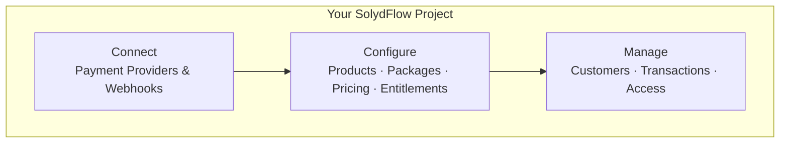
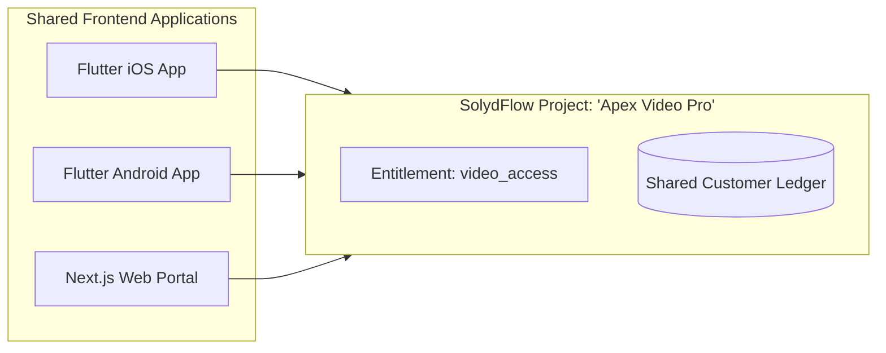

# Projects

A **Project** is the top-level boundary in SolydFlow that encapsulates your entire revenue infrastructure, monetization models, provider credentials, and financial ledgers.



---

## What Lives Inside a Project?

Each project maintains completely isolated instances of:

* **Payment Gateway Vault:** Encrypted BYOK credentials for Paystack, Flutterwave, Monnify, M-Pesa, and Stripe.
* **Monetization Matrix:** Product definitions, packages, durations, and localized pricing overrides.
* **Entitlements:** Access permissions (e.g., `pro_access`, `vip_tier`) mapped to packages.
* **API Credentials:** Public Keys (`sf_pk_...`) and Webhook Signing Secrets (`whsec_...`).
* **Customer Directory & Ledger:** User purchase histories, active subscription timestamps, and tamper-proof consensus records.

---

## Architectural Decision: Single Project vs. Multiple Projects

### Scenario A: Single Project (Recommended for Cross-Platform Apps)

Use a **single project** when your users should have unified access across multiple platforms (e.g., Mobile and Web).



:::tip{title="Cross-Platform Access Benefit"}
A customer who purchases `video_access` on their Android phone via **Paystack USSD** will immediately have `video_access` recognized when logging into your **Next.js Web Portal**, because both applications point to the same SolydFlow project.
:::

---

### Scenario B: Multiple Projects (Recommended for Distinct Products)

Use **separate projects** when you operate distinct applications with different merchant bank accounts, unique customer bases, or completely different pricing catalogs.

```text
Your Organization
│
├── 📁 Project: "LMS EdTech App"
│   ├── Currency: NGN / KES
│   ├── Payout Account: GTBank (Nigeria)
│   └── Entitlements: course_access, certificate_access
│
└── 📁 Project: "B2B Logistics API"
    ├── Currency: USD / EUR
    ├── Payout Account: Silicon Valley Bank / Stripe
    └── Entitlements: api_pro_tier, high_throughput
```

---

## Environment Isolation: Sandbox vs. Live

Every SolydFlow project provides two isolated runtime modes:

| Feature | Sandbox (Test Mode) | Live (Production Mode) |
| :--- | :--- | :--- |
| **Publishable Key** | `sf_pk_test_...` | `sf_pk_live_...` |
| **Webhook Secret** | `whsec_test_...` | `whsec_live_...` |
| **Gateway Keys** | Gateway Test API Keys (`sk_test_...`) | Gateway Live Secret Keys (`sk_live_...`) |
| **Real Money Moved?** | **No.** Uses test cards and simulator STK pushes. | **Yes.** Debits real bank cards, accounts, and mobile wallets. |
| **Ledger Storage** | Sandbox Ledger (Reset anytime). | Immutable Production Ledger (Permanent audit trail). |

---

## Security Best Practices

1. **Client Isolation:** Only distribute your **Publishable Keys** (`sf_pk_...`) in client codebases (Flutter, React, iOS, Android).
2. **Backend Secret Protection:** Keep your **Webhook Signing Secrets** (`whsec_...`) stored securely in environment variables on your backend servers.
3. **No Direct Gateway Exposure:** Your mobile and web clients never interact directly with Paystack, Flutterwave, or Stripe API keys. SolydFlow securely signs and routes transactions through your project's AES-256 encrypted vault.

---

## Related Documentation

* **[Users & Identity →](./users.md)**
* **[Products & Packages →](./products.md)**
* **[Entitlements Architecture →](./entitlements.md)**
* **[API Credentials & Vault Security →](../security/credential-security.md)**