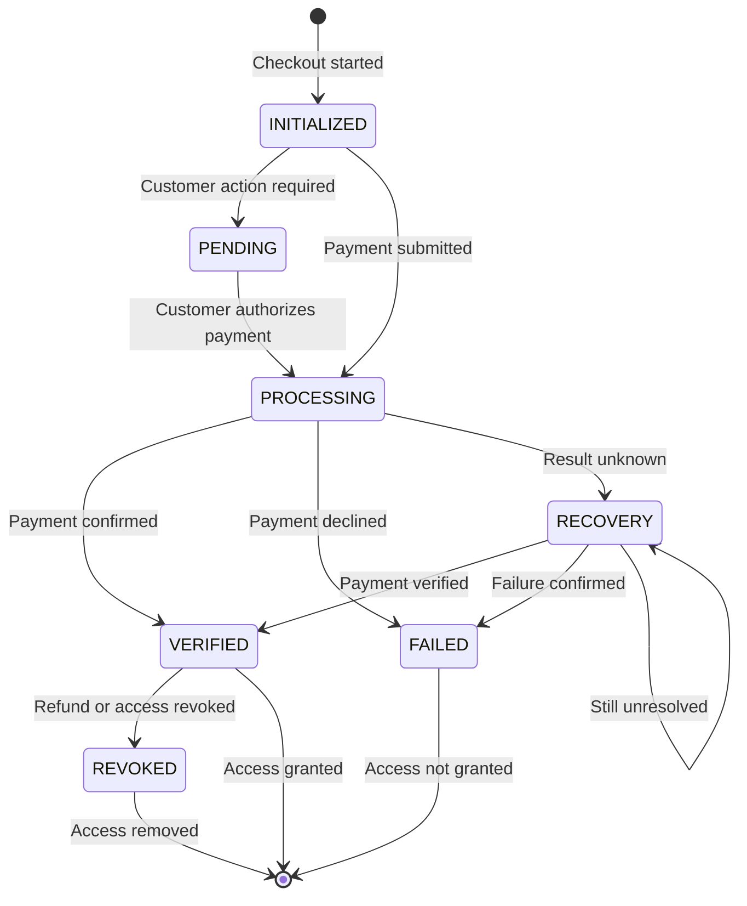

# Transaction States & Lifecycle

A **Transaction State** represents the precise financial and operational stage of a payment attempt as it moves through the SolydFlow revenue engine.



---

## The SolydFlow Unified State Machine

SolydFlow normalizes payment quirks across all gateways into eight distinct states:

### 1. Transient (Non-Final) States

| State | Description | Entitlement Status |
| :--- | :--- | :--- |
| **`INITIALIZED`** | The intent was generated by the SDK. Awaiting user interaction. | Locked 🔒 |
| **`PENDING_CHALLENGE`** | Waiting on user action (e.g., bank OTP, 3D-Secure modal, or M-Pesa USSD PIN entry). | Locked 🔒 |
| **`PROCESSING`** | Payment submitted. The payment rail is clearing funds with the issuing bank. | Locked 🔒 |
| **`UNRESOLVED`** | Payment initiated, but user closed app or callback timed out without final confirmation. | Held in Review ⏳ |
| **`RECOVERING`** | The SolydFlow **Sweeper** is actively polling the provider's REST verification endpoint. | Held in Review ⏳ |

:::warning{title="Never Assume Failure on Non-Final States"}
If a user closes their browser or their mobile data drops while in `PROCESSING` or `UNRESOLVED`, **never display a "Payment Failed" error**. The transaction is routed into `RECOVERING` and will settle automatically once consensus is established.
:::

---

### 2. Authoritative (Final) States

| State | Description | Entitlement Status |
| :--- | :--- | :--- |
| **`SETTLED_CONSENSUS`** | **Final Success.** The payment is cryptographically verified by the Consensus Engine. | **Unlocked ✅** |
| **`FAILED_DECLINED`** | **Final Failure.** Gateway confirmed insufficient funds, expired card, or invalid PIN. | Locked 🔒 |
| **`REVOKED_REFUND`** | **Final Reversal.** A dispute, chargeback, or admin refund cancelled the transaction. | **Revoked ❌** |

---

## Gateway Normalization Matrix

Different gateways use conflicting nomenclature for similar payment conditions. SolydFlow maps them to unified states:

| Scenario | Paystack State | Flutterwave State | Stripe State | M-Pesa (Daraja) | SolydFlow Normalized State |
| :--- | :--- | :--- | :--- | :--- | :--- |
| STK / OTP Prompt | `send_otp` | `pending-otp` | `requires_action` | STK Sent | **`PENDING_CHALLENGE`** |
| Dropped Callback | `ongoing` / None | `unknown` / None | `processing` | No Webhook | **`UNRESOLVED`** |
| Verified Success | `success` | `successful` | `succeeded` | `ResultCode: 0` | **`SETTLED_CONSENSUS`** |
| User Cancelled | `abandoned` | `cancelled` | `canceled` | `ResultCode: 1032`| **`FAILED_DECLINED`** |
| Bank Chargeback | `reversed` | `chargeback` | `charge.dispute` | Reversal | **`REVOKED_REFUND`** |

---

## How Your Application Should Handle States

Your client-side code should never parse gateway status strings. Rely on the SDK's high-level entitlement methods:

```dart title="State Handling Best Practice (Flutter)"
Future<void> handlePurchaseFlow(BuildContext context, String packageId) async {
  // 1. Initiate purchase - SDK manages INITIALIZED, PENDING, & PROCESSING
  final CustomerInfo? info = await SolydFlow.purchasePackage(context, packageId);

  // 2. User dismissed modal before submitting
  if (info == null) {
    debugPrint("Purchase modal dismissed.");
    return;
  }

  // 3. Evaluate Authoritative Settlement
  if (info.activeEntitlements["pro_access"] == true) {
    // SETTLED_CONSENSUS achieved
    ScaffoldMessenger.of(context).showSnackBar(
      const SnackBar(content: Text("🎉 Pro access unlocked!")),
    );
  } else {
    // SDK will quietly recover in background if state is UNRESOLVED
    ScaffoldMessenger.of(context).showSnackBar(
      const SnackBar(content: Text("Verifying payment... Check back shortly.")),
    );
  }
}
```

---

## Related Documentation

* **[Transactions Architecture →](./transactions.md)**
* **[Recovering Orphaned Transactions →](../recover/orphaned-transactions.md)**
* **[Truth & Consensus Engine →](../truth/consensus-engine.md)**
* **[Enforcing Entitlements →](../enforce/entitlement-enforcement.md)**
