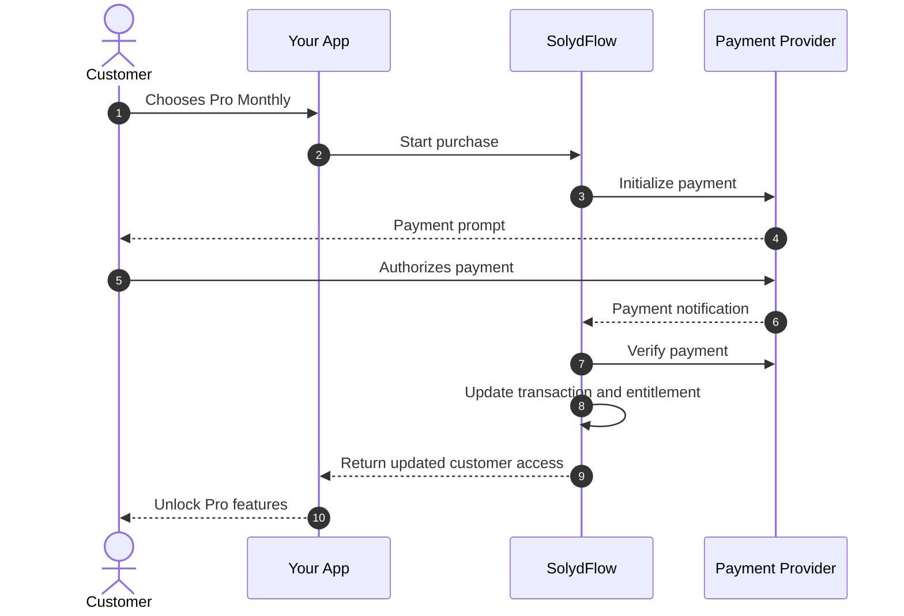

# Transactions & Financial Ledger

In SolydFlow, a **Transaction** represents the complete financial journey of a purchase attempt. 

Unlike a simple gateway callback, a SolydFlow Transaction is an immutable audit record tracking every state change—from initial checkout intent and gateway routing, through server-to-server consensus verification, to final entitlement enforcement.



---

## Transaction Record Schema

Every transaction record written to your project's Immutable Ledger contains detailed audit metadata:

```json title="Transaction Object (JSON)"
{
  "transaction_id": "txn_01J8K9B2D7E4F1A0C5E8",
  "project_id": "proj_apex_production",
  "user_id": "usr_supabase_991823",
  "package_id": "pro_monthly_ngn",
  "entitlement": "pro_access",
  "pricing": {
    "currency": "NGN",
    "amount_minor": 500000,
    "human_readable": "₦5,000.00",
    "is_upgrade": false
  },
  "provider": {
    "rail": "paystack",
    "provider_reference": "ref_pstk_89283ab71928",
    "channel": "card",
    "last4": "4081"
  },
  "state": "SETTLED_CONSENSUS",
  "lifecycle": {
    "initialized_at": "2026-08-27T10:14:20Z",
    "verified_at": "2026-08-27T10:14:35Z",
    "expires_at": "2026-09-27T10:14:35Z"
  },
  "metadata": {
    "ip_country": "NG",
    "app_version": "2.4.0",
    "platform": "flutter_android"
  }
}
```

---

## Why Transactions Require Independent Tracking

Emerging market payment flows are prone to edge cases that break standard architectures:

```text
┌───────────────────────────────────────┬──────────────────────────────────────────┐
│ Real-World Edge Case                  │ How SolydFlow Handles It                 │
├───────────────────────────────────────┼──────────────────────────────────────────┤
│ Customer closes app before redirect   │ Sweeper matches intent with provider logs│
├───────────────────────────────────────┼──────────────────────────────────────────┤
│ Delayed M-Pesa STK push (2 mins late) │ Consensus engine verifies asynchronous callback │
├───────────────────────────────────────┼──────────────────────────────────────────┤
│ Gateway retries duplicate webhooks    │ Strict idempotency on transaction_id     │
├───────────────────────────────────────┼──────────────────────────────────────────┤
│ Fraudulent/spoofed client callbacks   │ Zero trust in client; direct API check   │
└───────────────────────────────────────┴──────────────────────────────────────────┘
```

---

## Strict Idempotency & Replay Defense

Payment gateways frequently deliver duplicate webhooks when acknowledging network timeouts. SolydFlow enforces cryptographic idempotency:

1. **Unique Intent Matching:** Every checkout generates a deterministic `transaction_id`.
2. **Atomic Ledger Commits:** If a gateway sends five identical `charge.success` events for the same payment reference, the Consensus Engine processes the first and acknowledges subsequent duplicates as `NOOP` (No Operation).
3. **Zero Double-Crediting:** Customers are never granted duplicate entitlement durations or double-charged for consumable packs.

---

## Transaction Lookup & Reconciliation

When investigating billing disputes or verifying account upgrades, search the **SolydFlow Console → Transactions Ledger** using any of the following keys:

* **SolydFlow Transaction ID:** `txn_01J8K...`
* **Internal User ID:** `usr_supabase_991823`
* **Gateway Reference:** `ref_pstk_89283...` or Stripe `pi_3Mzx...`
* **Customer Email / Phone:** `customer@example.com` / `+2348012345678`

---

## Related Documentation

* **[Transaction States & Lifecycle →](./transaction-states.md)**
* **[Truth & Consensus Engine →](../truth/overview.md)**
* **[Recovering Orphaned Transactions →](../recover/orphaned-transactions.md)**
* **[Webhook Event Handling →](../webhooks/event-handling.md)**
