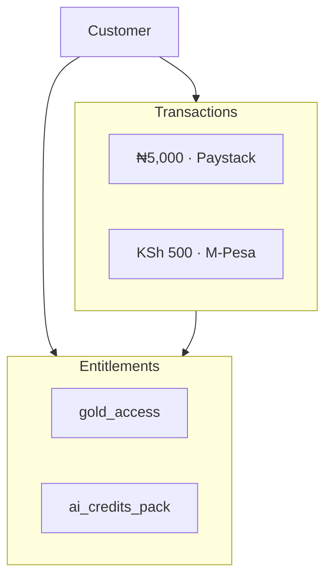
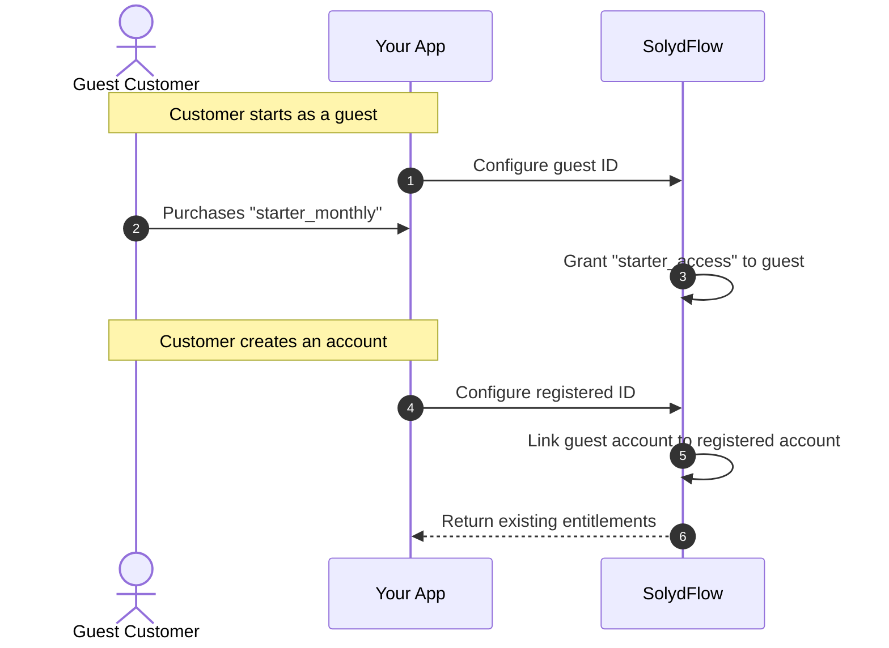

import Tabs from '@theme/Tabs';
import TabItem from '@theme/TabItem';

# Users & Customer Identity

In SolydFlow, a **User** represents a customer within a specific project. SolydFlow does not manage authentication, passwords, or session cookies—your application remains the single source of truth for user identities.



---

## Mapping Your Auth System to SolydFlow

Pass your authenticated user's unique identifier directly to the SDK during configuration:

<Tabs>
<TabItem value="flutter" label="Flutter (Firebase / Supabase)" default>

```dart title="lib/services/auth_sync.dart"
import 'package:firebase_auth/firebase_auth.dart';
import 'package:solydflow_flutter/solydflow_flutter.dart';

Future<void> syncSolydFlowUser(User firebaseUser) async {
  // Pass the stable Firebase UID along with customer contact data
  await SolydFlow.configure(
    apiKey: "sf_pk_live_44019283bc918237fa",
    userID: firebaseUser.uid, // e.g., "z8Q9w1kLmNP45"
    userEmail: firebaseUser.email ?? "customer@example.com",
    userPhone: firebaseUser.phoneNumber ?? "+2348012345678",
  );
}
```

</TabItem>
<TabItem value="javascript" label="JavaScript / TypeScript (Supabase / Next.js)">

```typescript title="src/auth.ts"
import { createClient } from "@supabase/supabase-js";
import { SolydFlow } from "solydflow-js";

export async function onSupabaseLogin(supabaseUser: any) {
  await SolydFlow.configure(
    process.env.NEXT_PUBLIC_SOLYDFLOW_KEY!,
    supabaseUser.id, // e.g., "d3b07384-d113-4a44-9982-128492048591"
    supabaseUser.email,
    supabaseUser.phone // e.g., "+254712345678"
  );
}
```

</TabItem>
</Tabs>

---

## The Role of Contact Identifiers (`userEmail` & `userPhone`)

While only `userID` is strictly required to initialize the SDK, providing `userEmail` and `userPhone` is strongly recommended for African and cross-border operations:

| Identifier | Critical Use Cases | Format Example |
| :--- | :--- | :--- |
| **`userID`** | Permanent primary key for ledger records, entitlement grants, and cross-device sync. | `usr_89283ab` or UUID |
| **`userEmail`** | Gateway dispute matching, Paystack/Stripe customer receipts, and automated email recovery workflows. | `ada@company.com` |
| **`userPhone`** | **M-Pesa STK Push execution**, WhatsApp churn recovery campaigns, and SMS transaction failover alerts. | `+2348012345678`<br/>`+254712345678` (E.164) |

:::tip{title="M-Pesa Requirement"}
When routing transactions through Kenyan payment rails (M-Pesa / Daraja), Safaricom requires a valid MSISDN phone number to prompt the customer for their M-Pesa PIN. Supplying `userPhone` ensures the checkout completes without prompting the user for manual entry.
:::

---

## One User, Multiple Purchases & Entitlements

A single user can accumulate multiple active subscriptions, one-off purchases, and add-on permissions over time:

```dart title="Checking Multiple Entitlements in Flutter"
// Check core tier access
bool hasPro = await SolydFlow.hasEntitlement("pro_tier");

// Check add-on feature permission
bool hasAdvancedAnalytics = await SolydFlow.hasEntitlement("analytics_add_on");

if (hasPro && hasAdvancedAnalytics) {
  // Render premium chart visualizations
}
```

---

## Handling Guest & Anonymous Users

If your application allows users to explore before creating an account, follow the **Anonymous Aliasing Pattern**:



---

## Best Practices

* ✅ **Use Permanent IDs:** Use immutable database primary keys (UUIDs or auth provider UIDs) instead of usernames or device IDs that can change.
* ✅ **International E.164 Phone Format:** Always prepend country codes (e.g., `+234...`, `+254...`, `+233...`) to enable cross-border mobile money routing.
* ❌ **Never Hardcode Provider Customer IDs:** Do not use gateway customer IDs (like `CUS_paystack_xxx` or `cus_stripe_xxx`) as your primary `userID`. Gateway IDs can change if you migrate or switch routing rules.
* ❌ **Do Not Share IDs Across Different People:** Avoid using static strings like `"guest_user"` for all unauthenticated users, as they would share one common entitlement state.

---

## Related Documentation

* **[Products & Packages Catalog →](./products.md)**
* **[Entitlements Architecture →](./entitlements.md)**
* **[Transactions & Consensus Ledger →](./transactions.md)**
* **[Transaction States & Lifecycle →](./transaction-states.md)**
