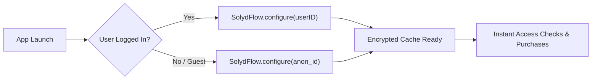

import Tabs from '@theme/Tabs';
import TabItem from '@theme/TabItem';

# Initializing SolydFlow

Initialize the SolydFlow SDK as early as possible in your application lifecycle—ideally right after your customer authenticates.



---

## Configuration Parameters

| Parameter | Type | Required | Description |
| :--- | :--- | :--- | :--- |
| `apiKey` | `String` | **Yes** | Your project public key (`sf_pk_test_...` or `sf_pk_live_...`). Safe for client apps. |
| `userID` | `String` | **Yes** | Unique identifier from your auth system (Firebase UID, Supabase UUID, or database ID). |
| `userEmail` | `String` | **Optional** | Customer email. Used for transaction receipts and churn recovery emails. |
| `userPhone` | `String` | **Recommended** | Phone number in international E.164 format (e.g., `+2348012345678`, `+254712345678`). **Required for M-Pesa STK push.** |

---

## Implementation Examples

<Tabs>
<TabItem value="flutter" label="Flutter (Auth Lifecycle)" default>

```dart title="lib/services/billing_service.dart"
import 'package:flutter/foundation.dart';
import 'package:solydflow_flutter/solydflow_flutter.dart';

class BillingService {
  /// Call this when the user logs in
  static Future<void> initializeUser({
    required String uid,
    required String email,
    String? phoneNumber,
  }) async {
    try {
      await SolydFlow.configure(
        // Use test key during development, live key in release builds
        apiKey: kDebugMode
            ? "sf_pk_test_a8f93b1c8e924a1b82"
            : "sf_pk_live_44019283bc918237fa",
        userID: uid,
        userEmail: email,
        userPhone: phoneNumber ?? "",
      );
      
      debugPrint("SolydFlow initialized for user: $uid");
    } catch (error) {
      debugPrint("Failed to initialize SolydFlow: $error");
    }
  }

  /// Call this when the user logs out to clear local encrypted cache
  static Future<void> logoutUser() async {
    await SolydFlow.reset();
  }
}
```

</TabItem>
<TabItem value="javascript" label="JavaScript / TypeScript (Web)">

```typescript title="src/services/billing.ts"
import { SolydFlow } from "solydflow-js";

export async function initializeSolydFlow(
  userId: string,
  email: string,
  phone?: string
) {
  try {
    await SolydFlow.configure(
      process.env.NODE_ENV === "production"
        ? "sf_pk_live_44019283bc918237fa"
        : "sf_pk_test_a8f93b1c8e924a1b82",
      userId,
      email,
      phone
    );

    console.log("SolydFlow web client initialized");
  } catch (error) {
    console.error("SolydFlow initialization error:", error);
  }
}
```

</TabItem>
</Tabs>

---

## Environment Keys

Always pair the correct API key with your current deployment environment:

* **Sandbox / Staging:** `sf_pk_test_...` (Communicates with gateway test environments).
* **Production:** `sf_pk_live_...` (Processes real card charges and mobile money deductions).

:::danger{title="Keep Secret Keys on the Backend"}
Your **Secret Keys** (`sf_live_...` and `sf_test_...`) should **only** reside on your backend server to verify webhook signatures. Never pass secret keys to `SolydFlow.configure()`.
:::

---

## Handling Guest / Anonymous Users

If your application allows users to explore paywalls before registering an account:

1. Generate a temporary anonymous ID (e.g., `anon_c89b12d847`).
2. Call `SolydFlow.configure(apiKey, "anon_c89b12d847")`.
3. When the customer completes registration or sign-in, call `SolydFlow.configure()` again with their permanent user ID. SolydFlow will automatically alias the records and transfer any active purchases.