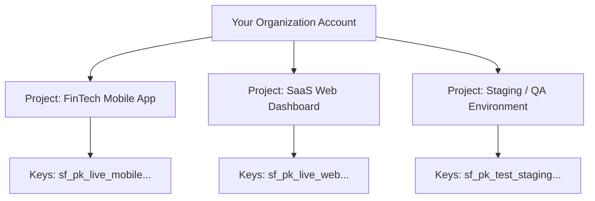

# Creating a Project

In SolydFlow, a **Project** represents an isolated revenue environment for a single application or product line. 

Each project maintains its own isolated:
* Payment provider accounts and credentials (BYOK Vault)
* Products, Packages, and Entitlements
* API Keys and Webhook Signing Secrets
* Customer profiles and Immutable Transaction Ledgers
* Smart Routing and Churn Protection rules

```text
Your SolydFlow Account
│
├── 📁 EdTech Mobile App (NGN / KES / USD)
├── 📁 SaaS Web Platform (USD / EUR)
└── 📁 Client Portal (Multi-currency)
```

---

## Step 1: Create a Project in the Console

1. Log in to the [SolydFlow Console](https://console.solydflow.com).
2. In the top navigation bar, click **Projects → New Project**.
3. Configure your project parameters:
   * **Project Name:** Enter a recognizable name (e.g., `Apex SaaS Production`).
   * **Base Reporting Currency:** Select the default currency for unified analytics (e.g., `NGN`, `KES`, `USD`, `GHS`, `ZAR`).
   * **Timezone:** Set your operational timezone for accurate daily churn and revenue aggregation.
4. Click **Create Project**.

---

## Step 2: Understand Environments (Sandbox vs. Live)

Every SolydFlow project operates across two distinct modes:

| Environment | Purpose | Key Prefixes | Gateway Mode |
| :--- | :--- | :--- | :--- |
| **Sandbox (Test)** | Local development, CI/CD testing, and QA validation. | `sf_pk_test_...`<br/>`sf_test_...` | Test Keys (`sk_test_...`, `FLWSECK_TEST...`) |
| **Live (Production)** | Real customer transactions, settlements, and live ledger records. | `sf_pk_live_...`<br/>`sf_live_...` | Live Merchant Keys (`sk_live_...`, `FLWSECK_LIVE...`) |

You can toggle between **Sandbox** and **Live** from the top bar of your SolydFlow Console at any time.

---

## Step 3: Retrieve Your Project Credentials

Navigate to **Project Settings → API Management** to view your keys:

### 1. Publishable Key (`sf_pk_...`)
* **Test:** `sf_pk_test_a8f93b1c8e924a1b82`
* **Live:** `sf_pk_live_44019283bc918237fa`
* **Usage:** Client-side SDKs (Flutter, React, Vue, Next.js, iOS, Android). Safe to ship inside public application builds.

### 2. Webhook Signing Secret (`sf_...`)
* **Test:** `sf_test_sec_7719283bc4`
* **Live:** `sf_live_sec_1029384bc9`
* **Usage:** Backend server environments only (Node.js, Python, Supabase, PHP). Used to cryptographically verify incoming `X-SolydFlow-Signature` webhook headers.

:::danger{title="Keep Backend Secrets Confidential"}

Never embed `sf_live_...` secrets or payment gateway secret keys inside mobile binaries or frontend client bundles. Doing so exposes your ledger controls and webhook verification keys.
:::

---

## Step 4: Add Gateway Keys to the Credentials Vault

SolydFlow utilizes a **Bring Your Own Keys (BYOK)** architecture. SolydFlow does not hold your funds—payments settle directly into your merchant accounts.

1. In the console sidebar, open **Settings → API Credentials Vault**.
2. Expand the gateway you want to connect (e.g., Paystack, Flutterwave, Stripe).
3. Enter both your **Test** and **Live** provider secret keys.
4. Click **Save Encrypted Configuration** (all keys are encrypted at rest using AES-256-GCM).

---

## Multi-Project Workflows

If you manage multiple independent applications or distinct staging environments, create separate projects:



This guarantees that customer IDs, subscription lifecycles, and financial ledgers never overlap across platforms.