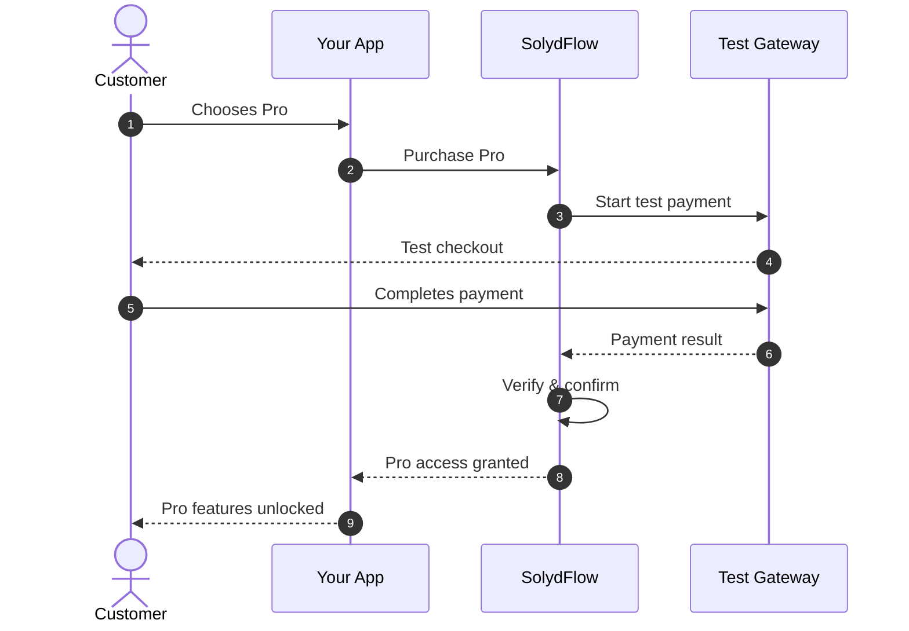

import Tabs from '@theme/Tabs';
import TabItem from '@theme/TabItem';

# Making Your First Purchase

This guide walks you through fetching active packages, executing a sandbox checkout, and gating features based on verified entitlements.



---

## 1. Fetch Available Offerings

Before displaying pricing to the customer, retrieve the localized offerings configured in your SolydFlow Console:

<Tabs>
<TabItem value="flutter" label="Flutter" default>

```dart title="lib/screens/pricing_screen.dart"
import 'package:flutter/material.dart';
import 'package:solydflow_flutter/solydflow_flutter.dart';

Future<List<SolydPackage>> loadPackages() async {
  try {
    final List<SolydPackage> offerings = await SolydFlow.getOfferings();
    return offerings;
  } catch (e) {
    debugPrint("Failed to fetch offerings: $e");
    return [];
  }
}
```

</TabItem>
<TabItem value="javascript" label="JavaScript / TypeScript (Web)">

```typescript title="src/pricing.ts"
import { SolydFlow } from "solydflow-js";

async function loadOfferings() {
  try {
    const offerings = await SolydFlow.getOfferings();
    offerings.forEach((pkg) => {
      console.log(`${pkg.name}: ${pkg.currency} ${pkg.amount_minor}`);
    });
    return offerings;
  } catch (error) {
    console.error("Failed to load offerings:", error);
  }
}
```

</TabItem>
</Tabs>

---

## 2. Execute the Purchase

When the customer selects a plan, invoke `purchasePackage`. Always handle the three distinct outcomes:

1. **Success:** `CustomerInfo` is returned with active entitlements.
2. **User Cancelled:** Returns `null` when the user closes the modal without paying.
3. **Failure:** Throws an exception on card decline, invalid network, or gateway timeout.

<Tabs>
<TabItem value="flutter" label="Flutter (Custom UI Flow)" default>

```dart title="lib/screens/pricing_screen.dart"
Future<void> buySubscription(BuildContext context, String packageId) async {
  try {
    // 1. Trigger purchase modal / payment rail
    final CustomerInfo? customerInfo = await SolydFlow.purchasePackage(
      context,
      packageId,
    );

    // 2. Handle user dismissal
    if (customerInfo == null) {
      debugPrint("User closed the checkout sheet without paying.");
      return;
    }

    // 3. Verify entitlement activation
    if (customerInfo.activeEntitlements["pro_access"] == true) {
      if (!context.mounted) return;
      Navigator.of(context).pop();
      ScaffoldMessenger.of(context).showSnackBar(
        const SnackBar(content: Text("🎉 Welcome to Pro!")),
      );
    }
  } catch (error) {
    // 4. Handle gateway/network errors
    if (!context.mounted) return;
    ScaffoldMessenger.of(context).showSnackBar(
      SnackBar(content: Text("Payment failed: $error")),
    );
  }
}
```

</TabItem>
<TabItem value="javascript" label="JavaScript / TypeScript (Web Redirect)">

```typescript title="src/checkout.ts"
import { SolydFlow } from "solydflow-js";

async function initiateCheckout(packageId: string) {
  try {
    // Web SDK automatically redirects to the hosted Smart-Routed payment rail
    await SolydFlow.purchasePackage(
      packageId,
      "+2348012345678" // Customer phone number
    );
  } catch (error: any) {
    alert(`Checkout initiation failed: ${error.message}`);
  }
}
```

</TabItem>
</Tabs>

---

## Alternative: Using the Drop-In No-Code Paywall

If you want to publish paywalls designed directly in the SolydFlow Console without writing custom UI code:

<Tabs>
<TabItem value="flutter" label="Flutter (SolydPaywall Widget)" default>

```dart title="lib/screens/home_screen.dart"
import 'package:flutter/material.dart';
import 'package:solydflow_flutter/solydflow_flutter.dart';

void openNoCodePaywall(BuildContext context) {
  showModalBottomSheet(
    context: context,
    isScrollControlled: true,
    backgroundColor: Colors.transparent,
    builder: (ctx) => SolydPaywall(
      onPurchaseSuccess: (CustomerInfo info) {
        Navigator.pop(ctx);
        ScaffoldMessenger.of(ctx).showSnackBar(
          const SnackBar(content: Text("Subscription Unlocked! 🚀")),
        );
      },
      onClose: () => Navigator.pop(ctx),
    ),
  );
}
```

</TabItem>
<TabItem value="web" label="Web (Drop-In Container)">

```html title="index.html"
<div id="solydflow-paywall-container"></div>

<script type="module">
  import { SolydFlow } from "solydflow-js";

  await SolydFlow.configure(
    "sf_pk_test_a8f93b1c8e924a1b82",
    "usr_12345",
    "customer@example.com"
  );

  // Renders the console-designed paywall into the container
  await SolydFlow.renderPaywall("solydflow-paywall-container");
</script>
```

</TabItem>
</Tabs>

---

## 3. Gating Features with Entitlements

Check access anywhere in your application using `hasEntitlement`. On mobile, this executes against encrypted local cache in **< 5ms** without blocking the UI:

```dart title="lib/screens/dashboard_screen.dart"
Future<void> checkAccessAndNavigate(BuildContext context) async {
  final bool isPro = await SolydFlow.hasEntitlement("pro_access");

  if (isPro) {
    // Grant access to premium workspace
    Navigator.pushNamed(context, "/pro-workspace");
  } else {
    // Show paywall
    openNoCodePaywall(context);
  }
}
```

---

## 4. Testing in Sandbox

To test this flow:
1. Ensure your SDK is initialized with your **Test Public Key** (`sf_pk_test_...`).
2. When the checkout opens, use standard test card numbers provided by your gateway (e.g., Paystack/Stripe 4084 0841... or Flutterwave test OTP `12345`).
3. Complete the payment.
4. Verify that `pro_access` unlocks immediately and an immutable transaction is recorded in the **SolydFlow Console → Transactions** ledger.

---

## Related Documentation

* **[Entitlements Concept →](../concepts/entitlements.md)**
* **[Transactions & Consensus →](../concepts/transactions.md)**
* **[Testing in Sandbox →](../sandbox/overview.md)**