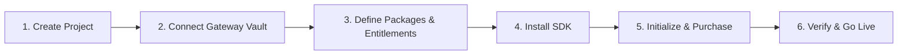

import Tabs from '@theme/Tabs';
import TabItem from '@theme/TabItem';

# SolydFlow Quickstart

Get your application processing verified subscriptions and granting entitlements in under 10 minutes.



---

## Prerequisites

1. A [SolydFlow Console](https://console.solydflow.com) account.
2. An active merchant account with at least one supported payment provider (e.g., Paystack, Flutterwave, or Stripe in Test or Live mode).
3. A Flutter application or modern JavaScript/TypeScript web app.

---

## 1. Create a Project & Retrieve API Keys

1. Log in to the [SolydFlow Console](https://console.solydflow.com) and select **New Project**.
2. Name your project (e.g., `Apex SaaS`).
3. Navigate to **Settings → API Keys** and copy your **Public Key**:
   * Test Mode: `sf_pk_test_...`
   * Live Mode: `sf_pk_live_...`

---

## 2. Connect Your Payment Provider (BYOK)

SolydFlow uses a **Bring Your Own Keys (BYOK)** model. You retain direct ownership of your merchant accounts, customer relationships, and bank payouts.

1. Go to **Settings → API Credentials Vault**.
2. Select your gateway (e.g., **Paystack**, **Flutterwave**, or **Stripe**).
3. Paste your gateway's **Secret Key** (`sk_test_...` / `sk_live_...`) and click **Save**.
4. Copy the unique **Inbound Gateway Webhook URL** generated in the console and paste it into your payment gateway’s webhook settings dashboard.

---

## 3. Configure Entitlements and Packages

In SolydFlow, access permissions are separated from billing items:

1. Navigate to **Entitlements → Create Entitlement**.
   * Identifier: `pro_access`
   * Description: *Full access to premium features*
2. Navigate to **Products → Create Package**.
   * Package Identifier: `pro_monthly`
   * Mapped Entitlement: `pro_access`
   * Base Price: `₦5,000` (NGN), `KSh 500` (KES), or `$4.99` (USD)

---

## 4. Install the SDK

<Tabs>
<TabItem value="flutter" label="Flutter" default>

Add `solydflow_flutter` to your `pubspec.yaml`:

```yaml title="pubspec.yaml"
dependencies:
  flutter:
    sdk: flutter
  solydflow_flutter:
    git:
      url: https://github.com/solydflow/solydflow_flutter.git
      path: sdk_flutter
      ref: v0.8.0
```

Then run:

```bash
flutter pub get
```

</TabItem>
<TabItem value="javascript" label="JavaScript / TypeScript">

Install `solydflow-js` via your preferred package manager:

```bash
npm install solydflow-js
# or
yarn add solydflow-js
# or
pnpm add solydflow-js
```

</TabItem>
</Tabs>

---

## 5. Initialize SolydFlow

Initialize the SDK as early as possible in your app lifecycle after the user signs in:

<Tabs>
<TabItem value="flutter" label="Flutter" default>

```dart title="lib/main.dart"
import 'package:flutter/material.dart';
import 'package:solydflow_flutter/solydflow_flutter.dart';

void main() async {
  WidgetsFlutterBinding.ensureInitialized();

  // Initialize SolydFlow with your Public Key and authenticated User ID
  await SolydFlow.configure(
    apiKey: "sf_pk_test_a8f93b1c8e924a1b82",
    userID: "usr_firebase_992182",
    userEmail: "customer@example.com",
    userPhone: "+2348012345678", // Recommended: Enables M-Pesa & SMS recovery
  );

  runApp(const MyApp());
}
```

</TabItem>
<TabItem value="javascript" label="JavaScript / TypeScript">

```typescript title="src/index.ts"
import { SolydFlow } from "solydflow-js";

await SolydFlow.configure(
  "sf_pk_test_a8f93b1c8e924a1b82",
  "usr_db_992182",
  "customer@example.com"
);
```

</TabItem>
</Tabs>

---

## 6. Make a Purchase & Check Access

<Tabs>
<TabItem value="flutter" label="Flutter" default>

```dart title="lib/screens/checkout_example.dart"
import 'package:flutter/material.dart';
import 'package:solydflow_flutter/solydflow_flutter.dart';

Future<void> handleSubscription(BuildContext context) async {
  try {
    // 1. Trigger the checkout flow for your package identifier
    final CustomerInfo? info = await SolydFlow.purchasePackage(
      context,
      "pro_monthly",
    );

    if (info == null) {
      // User dismissed or cancelled the modal
      return;
    }

    // 2. Check if the entitlement is unlocked
    if (info.activeEntitlements["pro_access"] == true) {
      ScaffoldMessenger.of(context).showSnackBar(
        const SnackBar(content: Text("🎉 Pro Access Activated!")),
      );
    }
  } catch (error) {
    debugPrint("Purchase failed: $error");
  }
}

// 3. Fast offline entitlement check (<5ms) anywhere in your app
Future<bool> checkUserAccess() async {
  return await SolydFlow.hasEntitlement("pro_access");
}
```

</TabItem>
<TabItem value="javascript" label="JavaScript / TypeScript">

```typescript title="src/checkout.ts"
import { SolydFlow } from "solydflow-js";

// 1. Trigger hosted web checkout redirect
async function buyPlan(packageId: string) {
  try {
    await SolydFlow.purchasePackage(
      packageId, 
      "+2348012345678" // Customer phone
    );
  } catch (err) {
    console.error("Checkout redirection failed:", err);
  }
}

// 2. Check entitlement state in web application
async function verifyAccess(): Promise<boolean> {
  return await SolydFlow.hasEntitlement("pro_access");
}
```

</TabItem>
</Tabs>

---

## 7. Test in Sandbox & Go Live

1. Use test card numbers or mobile money test prompts to simulate successful and failed payments in Test Mode (`sf_pk_test_...`).
2. Verify that **`pro_access`** is granted in the console's **Customers** tab.
3. Switch your API keys to Live Mode (`sf_pk_live_...`) in your production environment.

---

## Related Documentation

* **[Creating a Project →](./create-project.md)**
* **[SDK Installation Guide →](./install-sdk.md)**
* **[Connecting Payment Providers →](../payment-providers/overview.md)**
* **[Sandbox & Testing →](../sandbox/overview.md)**
