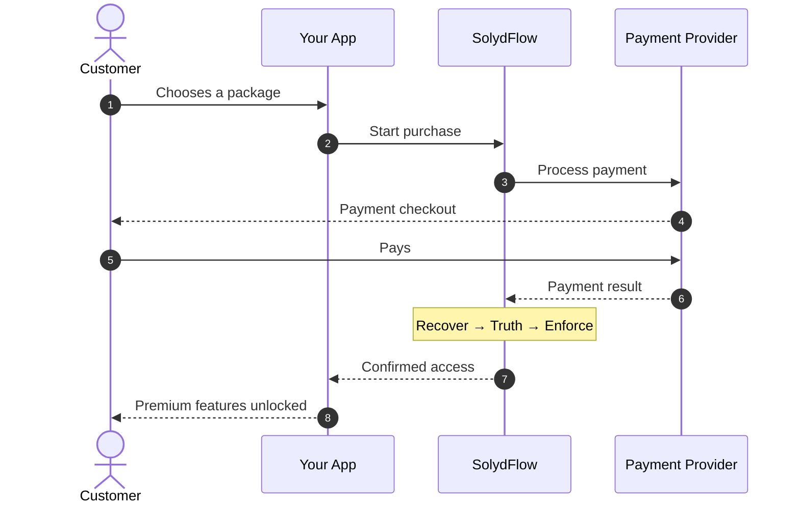
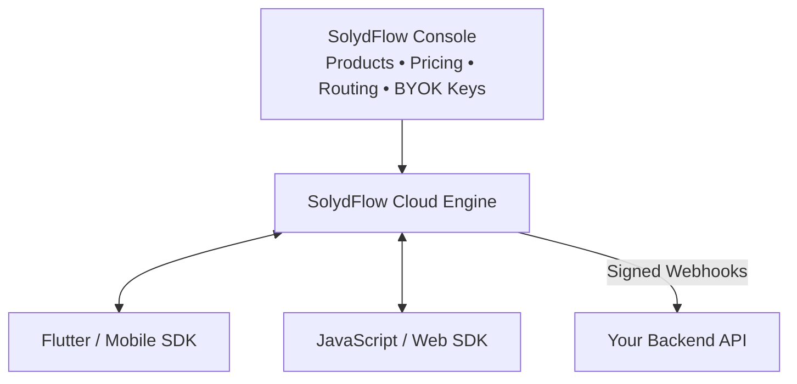

# Architecture & Transaction Flow

SolydFlow serves as the revenue orchestration and consensus layer between your client applications, your backend systems, and your payment providers.



> **What happens behind the scenes?**
>
> SolydFlow receives the payment result, recovers the transaction if necessary, verifies what actually happened, and applies the correct entitlement. Your app doesn't need to build this payment-recovery and verification logic itself.

---

## The 3 Pillars in Action

### 1. Recover (No Lost Revenue)
Payment flows often break in unstable network conditions or due to gateway delays. Recover actively rescues transactions when:
* A customer's USSD/M-Pesa payment confirms, but their cellular data cuts out before returning to your app.
* A gateway webhook is delayed or dropped due to network timeouts.
* A customer closes their browser tab immediately after authorizing a card charge.

The **Sweeper Engine** continuously matches pending intents against provider transaction logs, turning what would have been lost revenue or support tickets into completed subscriptions.

### 2. Truth (Zero Assumption Verification)
SolydFlow **never grants access based on client-side status codes or unverified webhook payloads**. 

When a payment provider notifies SolydFlow of a transaction:
1. Entitlement activation is temporarily held in a pending verification state.
2. SolydFlow queries the provider's authoritative REST API directly using your encrypted API keys from the **API Credentials Vault**.
3. SolydFlow verifies that the amount, currency, and customer reference match exactly.
4. Only when both the payload and the live API agree is a `SETTLED_CONSENSUS` event recorded.

### 3. Enforce (Unified Entitlement Layer)
Once truth is established, SolydFlow enforces access:
* **Offline-First Storage:** Entitlements are encrypted and cached locally on mobile devices using AES-GCM, allowing users to access paid features even with zero internet connectivity.
* **Universal Access:** Access is mapped to an **Entitlement ID** rather than a product or currency SKU.
* **Backend Webhook Dispatch:** Signed webhooks (`subscription_started`, `subscription_renewed`) are delivered to your servers with cryptographic replay protection.

---

## Developer Experience vs. Engine Operations

SolydFlow abstracts extreme payment complexity behind simple SDK calls:

```dart title="What you write in your App (Flutter Example)"
// 1. Check access anywhere in your app (runs offline in < 5ms)
bool isGold = await SolydFlow.hasEntitlement("gold_access");

// 2. Initiate purchase with 1 line of code
final customerInfo = await SolydFlow.purchasePackage(context, "gold_monthly");
```

```text title="What SolydFlow executes behind the scenes"
1. Detects user region (e.g. Kenya) and selects M-Pesa STK Push route.
2. Applies localized Purchasing Power Parity (KES pricing).
3. If the user had 10 days left on a Pro tier, computes pro-rated upgrade credit.
4. Initializes payment with Safaricom Daraja via your encrypted BYOK keys.
5. Verifies STK confirmation via server-to-server consensus check.
6. Writes immutable audit record to the ledger.
7. Updates encrypted device cache and unlocks "gold_access".
8. Dispatches signed webhook event to your backend API.
```

---

## Multi-Platform Architecture

Configure your packages, pricing, and routing rules once in the SolydFlow Console. Your mobile applications, web platforms, and backend services stay synchronized through a single source of truth:



---

## Related Documentation

* **[Quickstart Guide →](./get-started/quickstart.md)**
* **[Recover Engine Details →](./recover/overview.md)**
* **[Consensus & Truth →](./truth/overview.md)**
* **[Enforce & Entitlements →](./enforce/overview.md)**