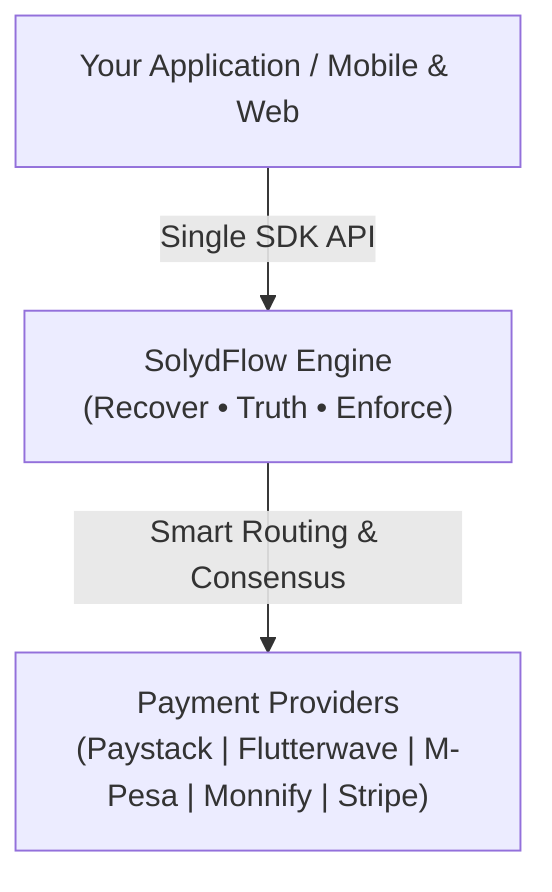
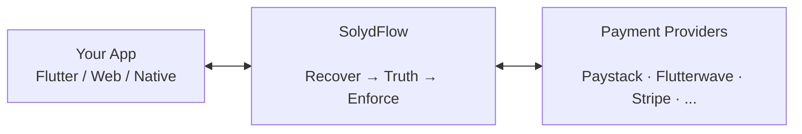

# What is SolydFlow?

SolydFlow is the revenue infrastructure for modern digital applications operating across African and global payment rails.

It provides a unified, resilient layer for connecting payment providers (Paystack, Flutterwave, Monnify, M-Pesa, Stripe), managing multi-currency pricing, processing transactions, recovering dropped payments, verifying financial consensus, and enforcing user entitlements.

Instead of writing fragmented billing logic, handling gateway-specific quirks, and building custom webhook retry queues for every app, you configure your revenue infrastructure once in SolydFlow and connect your client apps via SDK.



---

## Recover. Truth. Enforce.

SolydFlow is architected around three core responsibilities:

```text
               RECOVER
                  ↓
       Rescue interrupted or dropped
        transactions (Sweeper Engine)
                  ↓
                TRUTH
                  ↓
       Verify actual bank consensus 
         (Server-to-Server API check)
                  ↓
               ENFORCE
                  ↓
       Grant instant, offline-first 
       entitlements & ledger state
```

### 1. Recover
Network drops, closed browser tabs, and interrupted USSD/STK pushes happen constantly. SolydFlow’s Sweeper engine rescues dropped transactions and restores access even if the user closes the app mid-payment.

### 2. Truth
Never grant access based solely on unverified client responses or spoofable webhook payloads. SolydFlow queries provider APIs directly to establish cryptographically verified financial truth before recording transactions.

### 3. Enforce
Once truth is established, SolydFlow updates entitlements, synchronizes customer access across mobile and web platforms, and caches state locally for encrypted offline access.

---

## How SolydFlow Fits Into Your Stack

Your application handles user experience, your payment gateways process raw card/mobile money rails, and SolydFlow handles everything in between:



---

## Why SolydFlow Exists: Real-World Example

In emerging markets, payments rarely follow a pristine linear flow:

```text
User initiates ₦5,000 purchase via Paystack / USSD
    ↓
Bank debits user account
    ↓
Network times out before the redirect returns to your app
    ↓
[Standard Integration]: User charged, but features remain LOCKED ❌
    ↓
[SolydFlow Recovery]: Webhook/Sweeper intercepts transaction
    ↓
[SolydFlow Truth]: SolydFlow verifies settled status directly with Paystack API
    ↓
[SolydFlow Enforce]: "gold_access" unlocked on device automatically ✅
```

---

## Configure Once, Monetize Anywhere

Define your monetization matrix once in the SolydFlow Console:

| Plan Identifier | Local Pricing | Targeted Entitlement |
| :--- | :--- | :--- |
| `pro_monthly` | `₦5,000` (NGN), `KSh 500` (KES), `$4.99` (USD) | `pro_access` |
| `pro_yearly` | `₦50,000` (NGN), `KSh 5,000` (KES), `$49.99` (USD) | `pro_access` |

Both packages map to the same `pro_access` entitlement. Your application code only checks `hasEntitlement("pro_access")`, insulating your app logic from regional currencies, price updates, or provider migrations.

