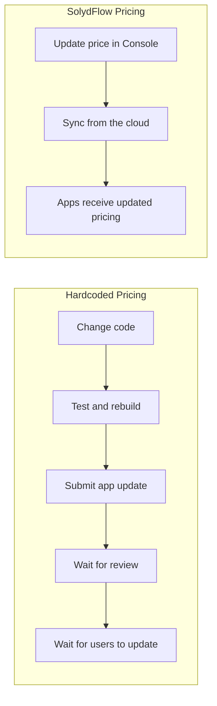
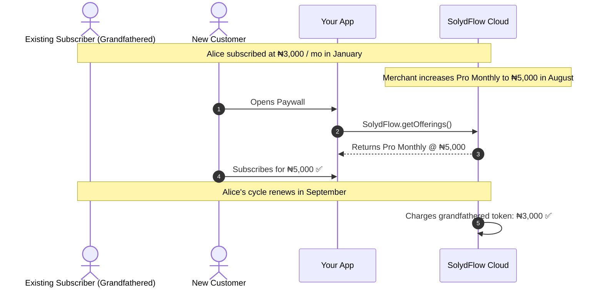

import Tabs from '@theme/Tabs';
import TabItem from '@theme/TabItem';

# Changing Pricing Safely

In SolydFlow, pricing is treated as **dynamic runtime configuration** rather than static application code. 

You can launch price increases, introduce annual plans, or adjust for regional inflation directly from the SolydFlow Console with zero app rebuilds or App Store review delays.



---

## The 3 Pricing Migration Strategies

When adjusting prices, choose the strategy that aligns with your business model:

| Strategy | When to Use | Existing Customers | New Customers |
| :--- | :--- | :--- | :--- |
| **1. Grandfathered In-Place Update** *(Recommended)* | Raising prices while protecting existing subscriber loyalty. | Retain original price (`₦3,000/mo`) on recurring cycles. | Charged new price (`₦5,000/mo`) immediately. |
| **2. Universal Price Hike** | Enforcing a global price increase across all active subscriptions. | Migrated to new rate on next billing cycle with email notice. | Charged new price immediately. |
| **3. SKU Sunsetting (Package Archival)** | Retiring a tier (e.g. *Legacy Lifetime Pass*). | Retain entitlement (`pro_access`) permanently. | Package hidden from paywall offerings. |

---

## 1. Grandfathering Existing Subscribers

When you edit a package's price in the SolydFlow Console:
* **The Immutable Ledger** preserves original purchase timestamps and historical pricing for past transactions.
* Active recurring authorization tokens (on Paystack, Stripe, or Flutterwave) continue renewing at the customer's initial grandfathered rate unless explicitly migrated.
* Any new customer fetching `SolydFlow.getOfferings()` receives the newly configured price.



---

## 2. Market-by-Market Inflation Calibration

You can adjust pricing in response to local currency fluctuations without touching global tiers:

```text
Product: "Pro Workspace" (pro_monthly)

Before:
├── 🇳🇬 Nigeria: ₦4,000 / mo
└── 🇺🇸 Global:  $4.99 / mo

After Inflation Review (Only NGN updated):
├── 🇳🇬 Nigeria: ₦6,500 / mo (Updated in Console)
└── 🇺🇸 Global:  $4.99 / mo (Unchanged)
```

The change takes effect instantly for Nigerian checkouts with zero changes to your frontend code.

---

## 3. Retiring & Sunsetting a Package

When deprecating an offering (e.g., removing a *Quarterly Plan*):

1. Navigate to **Console → Pricing & Products**.
2. Select the Package and toggle **Status: Archived (Hide from Offerings)**.
3. The package will no longer be returned by `SolydFlow.getOfferings()`.
4. **Active Entitlements are Protected:** Existing users who purchased the archived package retain their `pro_access` until their natural expiration date.

---

## Zero-Code Updates in Your Application

Because your app binds dynamically to `SolydPackage` properties, changes reflect immediately without code updates:

<Tabs>
<TabItem value="flutter" label="Flutter" default>

```dart title="lib/screens/paywall.dart"
// When you update prices from ₦5,000 to ₦6,500 in the Console,
// getOfferings() automatically fetches and renders the new amount on next launch.
Future<Widget> buildPaywall() async {
  final offerings = await SolydFlow.getOfferings();
  
  return ListView(
    children: offerings.map((pkg) => ListTile(
      title: Text(pkg.name),
      subtitle: Text("${pkg.currency} ${pkg.amountMinor}"),
    )).toList(),
  );
}
```

</TabItem>
<TabItem value="javascript" label="JavaScript / TypeScript (Web)">

```typescript title="src/pricing.ts"
// No hardcoded prices in your bundle
export async function getLivePrice(packageId: string): Promise<string> {
  const offerings = await SolydFlow.getOfferings();
  const pkg = offerings.find(p => p.identifier === packageId);
  return `${pkg?.currency} ${(pkg?.amount_minor ?? 0)}`;
}
```

</TabItem>
</Tabs>

---

## Pre-Flight Pricing Checklist

Before publishing a price increase:

- [ ] **Verify Currency & Units:** Confirm amount is entered in base units (e.g. `5000` NGN = `500000` kobo).
- [ ] **Verify Tier Level:** Ensure the package retains its correct `tier_level` for Smart Upgrade Credits.
- [ ] **Test in Sandbox First:** Use your `sf_pk_test_...` key to confirm the new price appears in test checkouts.
- [ ] **Review Active Webhooks:** Confirm your backend handles `subscription_renewed` payloads gracefully when the amount changes.

---

## Related Documentation

* **[Monetization Overview →](./overview.md)**
* **[Products & Packages Architecture →](./products-and-packages.md)**
* **[Regional Pricing & PPP →](./regional-pricing.md)**
* **[Production Deployment Checklist →](../production/production-checklist.md)**
