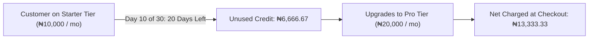

import Tabs from '@theme/Tabs';
import TabItem from '@theme/TabItem';

# Discounts & Smart Upgrade Credits

SolydFlow automates subscription discounts through **Smart Upgrade Credits**. 

Instead of requiring customers to hunt for coupon codes or forcing developers to build complex pro-ration engines, SolydFlow dynamically calculates the unused monetary value of an active subscription and deducts it as instant credit when upgrading to a higher tier.



---

## How Smart Upgrade Credits Work

Every Product/Package in SolydFlow is assigned a **Tier Level** (e.g., Free = 0, Starter = 1, Pro = 2, Business = 3).

When an authenticated user views your paywall:
1. SolydFlow detects if the customer has an active subscription at a lower `tier_level`.
2. The engine computes the remaining days in their current billing cycle.
3. If upgrading to a higher `tier_level` in the same currency, SolydFlow sets `pkg.isUpgrade = true` and populates `pkg.calculatedAmountMinor` with the discounted price.

---

## Pro-Rating Calculation Formula

```text
Unused Credit = (Remaining Days in Cycle / Total Days in Cycle) × Base Amount Paid

Net Amount Due = New Package Price − Unused Credit
```

### Real-World Example:
* **Current Plan:** *Starter Monthly* (₦10,000 paid for 30 days).
* **Upgrade Date:** Day 10 (20 days remaining).
* **Unused Credit Calculation:** `(20 / 30) × ₦10,000` = **₦6,666.67**
* **New Plan Price:** *Pro Monthly* = **₦20,000.00**
* **Final Checkout Charge:** `₦20,000 − ₦6,666.67` = **₦13,333.33**

---

## Displaying Upgrade Discounts in Code

<Tabs>
<TabItem value="flutter" label="Flutter (Strikethrough Price & Credit Badge)" default>

```dart title="lib/widgets/upgrade_package_card.dart"
import 'package:flutter/material.dart';
import 'package:intl/intl.dart';
import 'package:solydflow_flutter/solydflow_flutter.dart';

class UpgradePackageCard extends StatelessWidget {
  final SolydPackage package;
  final VoidCallback onSelect;

  const UpgradePackageCard({
    super.key,
    required this.package,
    required this.onSelect,
  });

  @override
  Widget build(BuildContext context) {
    final currencyFormatter = NumberFormat.simpleCurrency(name: package.currency);
    
    // Original full price
    final double fullPrice = package.amountMinor;
    
    // Net price after automatic upgrade credit
    final double netPrice = (package.isUpgrade ? package.calculatedAmountMinor : package.amountMinor);

    return Card(
      elevation: 2,
      margin: const EdgeInsets.symmetric(vertical: 8, horizontal: 16),
      child: Padding(
        padding: const EdgeInsets.all(16.0),
        child: Column(
          crossAxisAlignment: CrossAxisAlignment.start,
          children: [
            Row(
              mainAxisAlignment: MainAxisAlignment.spaceBetween,
              children: [
                Text(package.name, style: const TextStyle(fontSize: 18, fontWeight: FontWeight.bold)),
                if (package.isUpgrade)
                  Container(
                    padding: const EdgeInsets.symmetric(horizontal: 8, vertical: 4),
                    decoration: BoxDecoration(
                      color: Colors.green.shade100,
                      borderRadius: BorderRadius.circular(4),
                    ),
                    child: const Text("UPGRADE CREDIT APPLIED", style: TextStyle(color: Colors.green, fontSize: 10, fontWeight: FontWeight.bold)),
                  ),
              ],
            ),
            const SizedBox(height: 8),
            if (package.isUpgrade) ...[
              Text(
                currencyFormatter.format(fullPrice),
                style: const TextStyle(decoration: TextDecoration.lineThrough, color: Colors.grey, fontSize: 14),
              ),
            ],
            Text(
              "${currencyFormatter.format(netPrice)} / ${package.duration}",
              style: const TextStyle(fontSize: 22, fontWeight: FontWeight.bold, color: Colors.black),
            ),
            const SizedBox(height: 12),
            SizedBox(
              width: double.infinity,
              child: ElevatedButton(
                onPressed: onSelect,
                child: Text(package.isUpgrade ? "Upgrade Now" : "Subscribe"),
              ),
            ),
          ],
        ),
      ),
    );
  }
}
```

</TabItem>
<TabItem value="javascript" label="JavaScript / TypeScript (Web)">

```typescript title="src/components/UpgradeCard.ts"
import { SolydPackage } from "solydflow-js";

export function renderPackagePricingHTML(pkg: SolydPackage): string {
  const original = pkg.amount_minor;
  const net = (pkg.is_upgrade ? pkg.calculated_amount_minor : pkg.amount_minor);

  if (pkg.is_upgrade) {
    const savings = (original - net).toFixed(2);
    return `
      <div class="pricing-tier upgrade-active">
        <span class="badge">PRO-RATED UPGRADE CREDIT</span>
        <span class="strikethrough">${pkg.currency} ${original.toFixed(2)}</span>
        <h3>${pkg.currency} ${net.toFixed(2)} / ${pkg.duration}</h3>
        <p class="savings-note">You save ${pkg.currency} ${savings} from your active plan balance.</p>
      </div>
    `;
  }

  return `
    <div class="pricing-tier">
      <h3>${pkg.currency} ${original.toFixed(2)} / ${pkg.duration}</h3>
    </div>
  `;
}
```

</TabItem>
</Tabs>

---

## Accounting & Ledger Auditability

All applied credits are recorded in the Immutable Ledger to ensure accurate financial reporting:

```json title="Ledger Entry with Smart Credit (JSON)"
{
  "transaction_id": "txn_01J8K9B2D7E4F1A0C5E8",
  "user_id": "usr_supabase_991823",
  "package_id": "pro_monthly_ngn",
  "pricing": {
    "currency": "NGN",
    "original_amount_minor": 2000000,
    "upgrade_credit_minor": 666667,
    "final_charged_minor": 1333333,
    "human_readable_charged": "₦13,333.33"
  },
  "metadata": {
    "upgrade_from_package": "starter_monthly_ngn",
    "previous_tier_level": 1,
    "new_tier_level": 2,
    "unused_days_credited": 20
  }
}
```

---

## Related Documentation

* **[Products & Packages Architecture →](./products-and-packages.md)**
* **[Regional Pricing & Localization →](./regional-pricing.md)**
* **[Changing Pricing Safely →](./changing-pricing.md)**
* **[Transaction Ledger Architecture →](../truth/transaction-ledger.md)**
