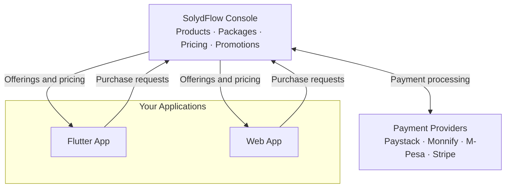

import Tabs from '@theme/Tabs';
import TabItem from '@theme/TabItem';

# Monetization Overview

SolydFlow provides a centralized control plane for configuring and managing your commercial business model without hardcoding pricing, SKUs, discounts, or gateway logic into your application binaries.



---

## The 4 Pillars of SolydFlow Monetization

SolydFlow structures monetization into four modular capabilities:

```text
┌───────────────────────────────────────┬────────────────────────────────────────────────────────┐
│ Pillar                                │ Capability & Business Impact                           │
├───────────────────────────────────────┼────────────────────────────────────────────────────────┤
│ 1. Products & Packages                │ Map business tiers (e.g. Pro) to single-currency SKUs.  │
├───────────────────────────────────────┼────────────────────────────────────────────────────────┤
│ 2. Regional Pricing & PPP             │ Maximize emerging market conversion with localized PPP.│
├───────────────────────────────────────┼────────────────────────────────────────────────────────┤
│ 3. Discounts & Promotions             │ Run percentage/fixed discount campaigns instantly.     │
├───────────────────────────────────────┼────────────────────────────────────────────────────────┤
│ 4. Changing Pricing                   │ Adjust pricing globally without shipping app updates.  │
└───────────────────────────────────────┴────────────────────────────────────────────────────────┘
```

---

## Real-World Multi-Market Matrix Example

Below is a complete example of how a single **"Pro Subscription"** product is monetized across multiple regions:

| Market | Currency | Package Identifier | Base Amount | PPP Localized Price | Primary Payment Rail |
| :--- | :--- | :--- | :--- | :--- | :--- |
| **Nigeria** | `NGN` | `pro_monthly_ngn` | `₦5,000` (500000 kobo) | Localized PPP | Paystack / Monnify |
| **Kenya** | `KES` | `pro_monthly_kes` | `KSh 500` (50000 cents) | Localized PPP | M-Pesa STK Push |
| **Ghana** | `GHS` | `pro_monthly_ghs` | `GH₵ 65` (6500 pesewas)| Localized PPP | Flutterwave |
| **South Africa** | `ZAR` | `pro_monthly_zar` | `R 99` (9900 cents) | Localized PPP | Paystack / Stripe |
| **Global / US** | `USD` | `pro_monthly_usd` | `$4.99` (499 cents) | Global Baseline | Stripe |

:::tip{title="Single Entitlement Target"}
All five regional packages above resolve to the **exact same entitlement: `pro_access`**. Your application code only checks `hasEntitlement("pro_access")`, completely abstracting away multi-currency complexity.
:::

---

## Developer Experience: Consuming Monetization in Code

Because monetization is centralized, fetching and rendering your complete regional pricing matrix requires minimal code:

<Tabs>
<TabItem value="flutter" label="Flutter" default>

```dart title="lib/screens/pricing_screen.dart"
import 'package:flutter/material.dart';
import 'package:solydflow_flutter/solydflow_flutter.dart';

Future<void> loadMonetization() async {
  // Automatically resolves user's region & currency
  List<SolydPackage> offerings = await SolydFlow.getOfferings();

  for (var pkg in offerings) {
    debugPrint("${pkg.name}: ${pkg.currency} ${pkg.amountMinor}");
  }
}
```

</TabItem>
<TabItem value="javascript" label="JavaScript / TypeScript (Web)">

```typescript title="src/monetization.ts"
import { SolydFlow } from "solydflow-js";

async function loadMonetization() {
  const offerings = await SolydFlow.getOfferings();
  
  offerings.forEach((pkg) => {
    console.log(`${pkg.name}: ${pkg.currency} ${pkg.amount_minor}`);
  });
}
```

</TabItem>
</Tabs>

---

## Explore Monetization Modules

Dive into specific monetization guides:

* **[Products & Packages →](./products-and-packages.md)** Learn how to structure offerings and single-currency SKUs.
* **[Regional Pricing & PPP →](./regional-pricing.md)** Configure Purchasing Power Parity across African and global markets.
* **[Discounts & Promotions →](./discounts.md)** Run flash sales, coupon codes, and promotional pricing.
* **[Changing Pricing Safely →](./changing-pricing.md)** Update prices and sunset legacy plans with zero subscriber disruption.
