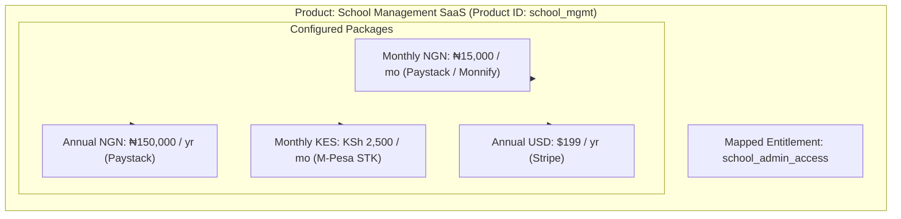

import Tabs from '@theme/Tabs';
import TabItem from '@theme/TabItem';

# Products & Packages Architecture

SolydFlow enforces a clear separation between **what you sell** (Product) and **how you offer it across markets and billing cycles** (Package).



---

## Decision Matrix: New Product vs. New Package

A frequent architectural question is whether a new monetization tier requires a new Product or simply another Package:

| Scenario | Recommendation | Rationale |
| :--- | :--- | :--- |
| **Adding an Annual or Quarterly billing cycle** | **New Package** | Same core offering, different billing cadence and discount. |
| **Adding localized pricing for Kenya (`KES`) or Nigeria (`NGN`)** | **New Package** | Same features, different regional currency and payment rail. |
| **Creating an App Store / Google Play SKU** | **New Package** | Same offering, linked to store IDs (`appleProductId`, `googleProductId`). |
| **Launching a standalone add-on (e.g. 500 AI SMS Tokens)** | **New Product** | Fundamentally different consumable offering and separate entitlement (`sms_tokens`). |
| **Introducing an Enterprise Tier with custom SLA and SAML SSO** | **New Product** | Distinct tier with a higher `tier_level` and unique entitlement (`enterprise_access`). |

> **Rule of Thumb:** Create a new **Product** when selling something fundamentally different or requiring a distinct entitlement. Create a new **Package** when changing the price, currency, cadence, or payment rail of an existing offering.

---

## Real-World Industry Implementations

### 1. African EdTech & School Management

An educational platform selling term-based and annual passes across Nigeria and Kenya:

```text
Product: "Primary School Suite" ➔ Entitlement: primary_school_access
├── Package: term_pass_ngn
│   ├── Price: ₦25,000 (3 Months / Term)
│   └── Rails: Paystack Card, USSD, Monnify Virtual Account
├── Package: term_pass_kes
│   ├── Price: KSh 3,500 (3 Months / Term)
│   └── Rails: M-Pesa STK Push
└── Package: annual_pass_ngn
    ├── Price: ₦70,000 (1 Year - Save ₦5,000)
    └── Rails: Paystack Card & Direct Bank Transfer
```

### 2. Multi-Tier B2B SaaS

A collaboration platform offering segmented plans with automatic upgrade credits:

```text
Product: "Pro Workspace" (Tier 1) ➔ Entitlement: pro_workspace
├── Package: pro_monthly_usd ($19 / month)
└── Package: pro_annual_usd ($190 / year)

Product: "Enterprise Workspace" (Tier 2) ➔ Entitlement: enterprise_workspace
├── Package: ent_monthly_usd ($49 / month)
└── Package: ent_annual_usd ($490 / year)
```

:::tip{title="Automated Pro-Rating"}
When a customer on `pro_monthly_usd` upgrades to `ent_annual_usd`, SolydFlow detects the transition from **Tier 1** to **Tier 2**, computes remaining days of unused credit, and charges the pro-rated net amount automatically.
:::

---

## Consuming Packages in Application Code

The SDK fetches and normalizes packages for instant UI rendering:

<Tabs>
<TabItem value="flutter" label="Flutter" default>

```dart title="lib/screens/catalog_screen.dart"
import 'package:flutter/material.dart';
import 'package:solydflow_flutter/solydflow_flutter.dart';

Future<void> renderCatalog(BuildContext context) async {
  // 1. Fetch packages (automatically localized for user's country)
  final List<SolydPackage> offerings = await SolydFlow.getOfferings();

  for (final pkg in offerings) {
    debugPrint("------------------------------------------");
    debugPrint("Package: ${pkg.name} (${pkg.identifier})");
    debugPrint("Duration: ${pkg.duration}");
    debugPrint("Price: ${pkg.currency} ${pkg.amountMinor}");
    if (pkg.isUpgrade) {
      debugPrint("Upgrade Net Price: ${pkg.currency} ${pkg.calculatedAmountMinor}");
    }
  }
}
```

</TabItem>
<TabItem value="javascript" label="JavaScript / TypeScript (Web)">

```typescript title="src/catalog.ts"
import { SolydFlow } from "solydflow-js";

async function fetchCatalog() {
  const packages = await SolydFlow.getOfferings();

  return packages.map((pkg) => ({
    id: pkg.identifier,
    name: pkg.name,
    cadence: pkg.duration, // e.g. "P1M", "P1Y"
    currency: pkg.currency,
    displayPrice: `${pkg.currency} ${(pkg.is_upgrade ? pkg.calculated_amount_minor : pkg.amount_minor)}`,
    isUpgrade: pkg.is_upgrade,
  }));
}
```

</TabItem>
</Tabs>

---

## Related Documentation

* **[Regional Pricing & Purchasing Power Parity →](./regional-pricing.md)**
* **[Discounts & Promotional Codes →](./discounts.md)**
* **[Changing Pricing Safely →](./changing-pricing.md)**
* **[Entitlements Architecture →](../concepts/entitlements.md)**
