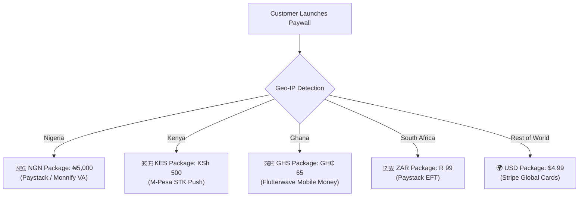

import Tabs from '@theme/Tabs';
import TabItem from '@theme/TabItem';

# Regional Pricing & Localization

Regional pricing allows you to offer the same core product across different countries at price points calibrated for local purchasing power, using local currencies and local payment methods.



---

## The Emerging Market Conversion Problem

Charging a flat global price (e.g. `$9.99 USD`) across all markets introduces major conversion bottlenecks:

1. **Purchasing Power Disparity:** In Nigeria or Kenya, $9.99 USD (~₦15,500 / ~KSh 1,300) can represent a prohibitive percentage of discretionary income.
2. **FX Volatility & Bank Limits:** Local bank cards frequently block international foreign currency (USD) transactions or impose extreme FX conversion surcharges.
3. **Unfamiliar Payment Rails:** Forcing a Kenyan user to enter credit card details instead of triggering an M-Pesa STK push reduces checkout completion rates by up to **70%**.

---

## Multi-Market Pricing & Rail Matrix

SolydFlow pairs localized pricing with local payment methods:

| Market | Currency | Recommended Local Price | Primary Gateway | Preferred Local Methods |
| :--- | :--- | :--- | :--- | :--- |
| **Nigeria** | `NGN` | `₦5,000` | Paystack / Monnify | Local Debit Cards, Bank Transfer, USSD |
| **Kenya** | `KES` | `KSh 500` | Safaricom (Daraja) / Paystack | **M-Pesa STK Push** |
| **Ghana** | `GHS` | `GH₵ 65` | Flutterwave | MTN Mobile Money, Telecel Cash |
| **South Africa** | `ZAR` | `R 99` | Paystack | Capitec Pay, Ozow Instant EFT |
| **United States / EU**| `USD` / `EUR` | `$4.99` / `€4.99` | Stripe | Apple Pay, Google Pay, Visa, Mastercard |

---

## Anti-Pattern vs. SolydFlow Best Practice

### ❌ The Anti-Pattern (Hardcoded Client-Side Logic)
Hardcoding country codes and currency logic inside your mobile or web app breaks whenever you update pricing or add a new country:

```typescript title="❌ Fragile & Hard to Maintain"
// Avoid this:
let price = 20; // Default USD
let currency = "USD";

if (user.country === "NG") {
  price = 5000;
  currency = "NGN";
} else if (user.country === "KE") {
  price = 500;
  currency = "KES";
}
```

---

### ✅ The SolydFlow Pattern (Dynamic Server-Driven Offerings)
The SDK resolves localized packages automatically based on Geo-IP and console routing rules:

<Tabs>
<TabItem value="flutter" label="Flutter" default>

```dart title="lib/screens/paywall_screen.dart"
import 'package:flutter/material.dart';
import 'package:intl/intl.dart';
import 'package:solydflow_flutter/solydflow_flutter.dart';

Widget buildLocalizedCard(SolydPackage pkg) {
  // SolydFlow automatically serves the correct currency & PPP amount
  final double displayPrice = pkg.amountMinor;
  final String formatted = NumberFormat.simpleCurrency(name: pkg.currency).format(displayPrice);

  return ListTile(
    title: Text(pkg.name),
    subtitle: Text("$formatted / ${pkg.duration}"),
    trailing: ElevatedButton(
      onPressed: () => SolydFlow.purchasePackage(context, pkg.identifier),
      child: const Text("Subscribe"),
    ),
  );
}
```

</TabItem>
<TabItem value="javascript" label="JavaScript / TypeScript (Web)">

```typescript title="src/pricing.ts"
import { SolydFlow } from "solydflow-js";

export async function getLocalizedCheckoutOfferings() {
  // Automatically detects user's country and returns the matched package
  const offerings = await SolydFlow.getOfferings();
  
  return offerings.map((pkg) => ({
    id: pkg.identifier,
    name: pkg.name,
    currency: pkg.currency,
    amount: (pkg.is_upgrade ? pkg.calculated_amount_minor : pkg.amount_minor),
  }));
}
```

</TabItem>
</Tabs>

---

## Regional Discounts & Promotions

You can attach promotional campaigns to specific markets without discounting global tiers. For example:
* **Independence Day Flash Sale (Nigeria):** Apply a **30% discount** only to `pro_monthly_ngn` (reducing price from `₦5,000` to `₦3,500`).
* **Global Base (`pro_monthly_usd`):** Remains untouched at `$4.99 USD`.

---

## Related Documentation

* **[Products & Packages Architecture →](./products-and-packages.md)**
* **[Discounts & Promotional Codes →](./discounts.md)**
* **[Changing Pricing Safely →](./changing-pricing.md)**
* **[Smart Payment Routing →](../enforce/smart-routing.md)**
