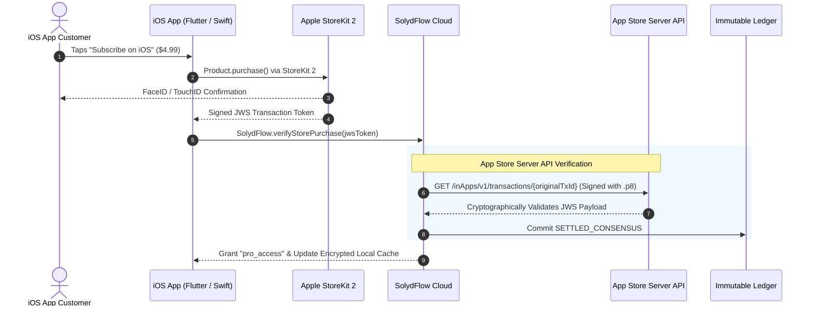

import Tabs from '@theme/Tabs';
import TabItem from '@theme/TabItem';

# Connecting Apple In-App Purchases

Connect your Apple Developer account to manage iOS In-App Purchases (StoreKit 2) and auto-renewable subscriptions alongside your web and African payment rails.

:::info{title="Status: Active Beta"}
Apple In-App Purchase integration is currently in testing. For production deployments using Paystack, Flutterwave, or Stripe, no Apple StoreKit setup is required.
:::



---

## Step 1: Add StoreKit API Credentials to the Vault

SolydFlow communicates with Apple's modern **App Store Server API** using a signed JSON Web Token (JWT).

1. Log in to [App Store Connect](https://appstoreconnect.apple.com).
2. Navigate to **Users and Access → Integrations → In-App Purchase**.
3. Generate an API Key and download your private key file (`AuthKey_XXXXXXXXXX.p8`).
4. Copy the:
   * **Key ID** (e.g., `2X9R4HXF34`)
   * **Issuer ID** (UUID from the top of the page)
   * **Bundle ID** (e.g., `com.company.myapp`)
5. Open the [SolydFlow Console](https://console.solydflow.com).
6. Go to **Project Settings → API Credentials Vault → Apple (StoreKit)**.
7. Paste your Key ID, Issuer ID, Bundle ID, and upload your `.p8` private key file.
8. Click **Save Encrypted Configuration**.

---

## Step 2: Configure App Store Server Notifications (ASSN v2)

Apple must notify SolydFlow when subscription renewals, refunds, or billing retries occur.

1. In the SolydFlow Console, navigate to **Project Settings → Inbound Gateway Webhook Configurations**.
2. Copy your unique Apple Inbound Webhook URL:
   ```text
   https://api.solydflow.com/api/v1/webhook/apple/{your_solydflow_api_key}
   ```
3. In App Store Connect, open your App and navigate to **App Information → App Store Server Notifications**.
4. Paste the SolydFlow URL into both the **Production Server URL** and **Sandbox Server URL** fields.
5. Select **Version 2 Notifications (ASSN v2)**.
6. Click **Save**.

---

## Step 3: Map Store Product IDs to Packages

Apple requires unique reverse-domain product identifiers. You link these IDs to your SolydFlow Packages in the console:

```text
┌─────────────────────────────────────────────────────────────┐
│ SolydFlow Package: pro_monthly_usd                          │
├─────────────────────────────────────────────────────────────┤
│ Base Price:         $4.99                                   │
│ Mapped Entitlement: pro_access                              │
│ Apple Product ID:   [ com.company.myapp.pro.monthly        ]│
│ Google Product ID:  [ com.company.myapp.pro.monthly.gplay  ]│
└─────────────────────────────────────────────────────────────┘
```

When running on iOS, the SolydFlow SDK automatically queries StoreKit using the configured `appleProductId`.

---

## Restoring Purchases in Code

Apple guidelines mandate that apps offering subscriptions must provide a **"Restore Purchases"** button for users reinstalling the app or switching devices:

<Tabs>
<TabItem value="flutter" label="Flutter" default>

```dart title="lib/screens/settings_screen.dart"
import 'package:flutter/material.dart';
import 'package:solydflow_flutter/solydflow_flutter.dart';

Future<void> handleRestorePurchases(BuildContext context) async {
  try {
    // Queries Apple StoreKit receipt & restores active entitlements in SolydFlow
    final CustomerInfo restoredInfo = await SolydFlow.restorePurchases();

    if (restoredInfo.activeEntitlements["pro_access"] == true) {
      ScaffoldMessenger.of(context).showSnackBar(
        const SnackBar(content: Text("🎉 Purchases successfully restored!")),
      );
    } else {
      ScaffoldMessenger.of(context).showSnackBar(
        const SnackBar(content: Text("No active subscriptions found to restore.")),
      );
    }
  } catch (error) {
    ScaffoldMessenger.of(context).showSnackBar(
      SnackBar(content: Text("Restore failed: $error")),
    );
  }
}
```

</TabItem>
</Tabs>

---

## Cross-Platform Entitlement Portability

Because SolydFlow abstracts monetization into the **Entitlements** layer:

```text
Customer purchases "pro_access" on iPhone via Apple In-App Purchase
    ↓
SolydFlow verifies receipt & records SETTLED_CONSENSUS in cloud ledger
    ↓
User logs into your Next.js Web App using the same user_id
    ↓
SolydFlow.hasEntitlement("pro_access") returns TRUE on Web ✅
```

Your customers never have to double-subscribe when switching between iOS, Android, and Web platforms.

---

## Related Documentation

* **[Google Play Billing Setup →](./google-play.md)**
* **[Connecting Stripe (Global Cards) →](./stripe.md)**
* **[Entitlements Architecture →](../concepts/entitlements.md)**
* **[Restore Purchases Workflow →](../recover/recovery-workflows.md)**

