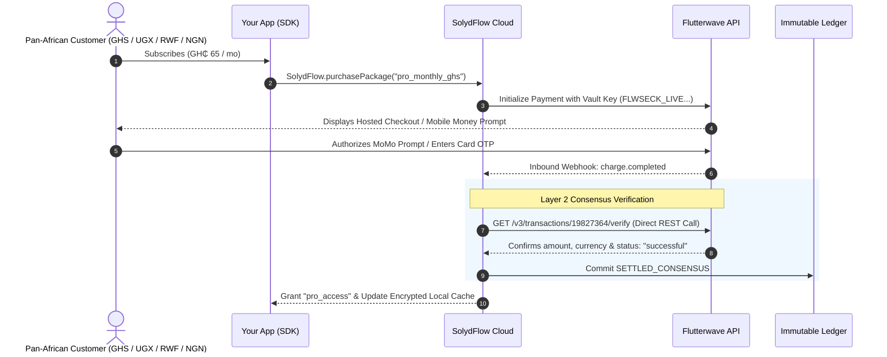

import Tabs from '@theme/Tabs';
import TabItem from '@theme/TabItem';

# Connecting Flutterwave

Connect your Flutterwave account to process Pan-African cards, Bank Accounts, and **Mobile Money (MoMo)** across 30+ African countries, including **Ghana, Nigeria, Kenya, Uganda, Rwanda, South Africa, and Francophone Africa**.

By integrating Flutterwave with SolydFlow's **Consensus Engine** and **Sweeper**, you eliminate webhook spoofing, handle slow telco networks, and enforce entitlements reliably.



---

## Step 1: Add Flutterwave Secret Keys to the Vault

SolydFlow requires your Flutterwave Secret Keys to initialize payments and independently verify transaction status directly against Flutterwave's v3 API.

1. Log in to your [Flutterwave Dashboard](https://dashboard.flutterwave.com).
2. Navigate to **Settings → API Keys**.
3. Copy your **Secret Key** (`FLWSECK_TEST...` for Sandbox and `FLWSECK_LIVE...` for Production).
4. Open the [SolydFlow Console](https://console.solydflow.com).
5. Go to **Project Settings → API Credentials Vault**.
6. Expand the **Flutterwave** section, paste both your Test and Live keys, and click **Save Encrypted Configuration**.

:::info{title="AES-256-GCM Encryption"}
All credentials stored in the SolydFlow Vault are encrypted using hardware-backed AES-256-GCM. Secret keys are never exposed to client applications.
:::

---

## Step 2: Configure the Inbound Webhook

Flutterwave must notify SolydFlow when asynchronous payment events (such as Mobile Money authorization or bank transfers) occur.

1. In the SolydFlow Console, navigate to **Project Settings → Inbound Gateway Webhook Configurations**.
2. Copy your unique Flutterwave Inbound Webhook URL:
   ```text
   https://api.solydflow.com/api/v1/webhook/flutterwave/{your_solydflow_api_key}
   ```
3. In your Flutterwave Dashboard, go to **Settings → Webhooks**.
4. Paste the URL into the **Webhook URL** field.
5. Click **Save Changes**.

---

## How SolydFlow Secures Flutterwave Transactions

SolydFlow **never grants access based solely on incoming webhook payloads**.

When Flutterwave sends a `charge.completed` webhook:
1. SolydFlow intercepts the incoming event.
2. Entitlement activation is temporarily paused.
3. The **Consensus Engine** makes a server-to-server call to Flutterwave (`GET /v3/transactions/{id}/verify`) using your encrypted `FLWSECK_LIVE...` key.
4. If the live API response confirms that the charged amount, currency, and customer reference match, SolydFlow commits a `SETTLED_CONSENSUS` record to the **Immutable Ledger**.
5. The user's entitlement (e.g. `pro_access`) is immediately granted and cached locally on the user's device for encrypted offline access.

This prevents:
* **Client response tampering:** Forging a success callback inside the app.
* **Webhook Replay Attacks:** Resending previously settled payloads.
* **Delayed MoMo drops:** Where telco networks delay confirmation, SolydFlow's Sweeper continuously polls the verification API until the transaction achieves consensus.

---

## Pan-African Payment Channels Supported

Through Flutterwave, SolydFlow supports regional payment rails across Africa:

| Country | Currency | Key Payment Rails |
| :--- | :--- | :--- |
| **Ghana** | `GHS` | MTN Mobile Money, Telecel Cash, AT Money, Local Cards |
| **Uganda** | `UGX` | MTN MoMo, Airtel Money |
| **Rwanda** | `RWF` | MTN Rwanda, Airtel Rwanda |
| **Nigeria** | `NGN` | Debit/Credit Cards, Direct Bank Transfer, USSD |
| **Kenya** | `KES` | M-Pesa, Airtel Money, Local Cards |
| **Francophone Africa** | `XOF` / `XAF` | Orange Money, Moov, Wave |

---

## Sandbox Testing Matrix

When developing with your `sf_pk_test_...` key, use standard Flutterwave test credentials:

| Test Scenario | Card / Number | Expiry | CVV | OTP Simulation | Expected Outcome |
| :--- | :--- | :--- | :--- | :--- | :--- |
| **Successful Card** | `4444 •••• •••• 4444` | Future date | `123` | `12345` | `SETTLED_CONSENSUS` (Granted) |
| **Card Declined** | `4444 •••• •••• 4441` | Future date | `123` | N/A | `FAILED_DECLINED` (No Access) |
| **Ghana MoMo Test** | `+233 24 000 0000` | N/A | N/A | `12345` | `SETTLED_CONSENSUS` (Granted) |
| **Uganda MoMo Test**| `+256 77 000 0000` | N/A | N/A | `12345` | `SETTLED_CONSENSUS` (Granted) |

---

## Related Documentation

* **[Connecting Paystack (Pan-Africa) →](./paystack.md)**
* **[Connecting M-Pesa (Kenya Mobile Money) →](./mpesa.md)**
* **[Connecting Stripe (Global Cards) →](./stripe.md)**
* **[Smart Payment Routing →](../enforce/smart-routing.md)**
