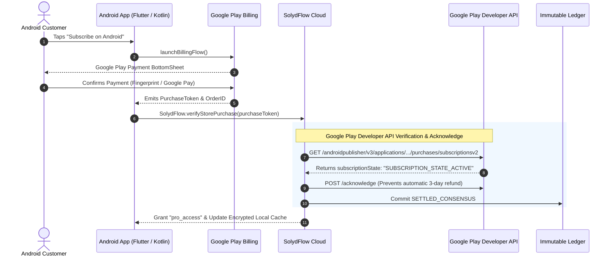

import Tabs from '@theme/Tabs';
import TabItem from '@theme/TabItem';

# Connecting Google Play Billing

Connect your Google Play Console to manage Android in-app purchases and auto-renewable subscriptions alongside your web and African payment rails.

:::info{title="Status: Active Beta"}
Google Play Billing integration is currently in testing. For production deployments using Paystack, Flutterwave, or Stripe, no Google Play configuration is required.
:::



---

## Step 1: Create a Google Cloud Service Account

SolydFlow communicates with the **Google Play Developer API** (`androidpublisher`) to verify purchase tokens and acknowledge subscriptions.

1. Open the [Google Cloud Console](https://console.cloud.google.com).
2. Ensure your project is linked to your Google Play Console account.
3. Navigate to **IAM & Admin → Service Accounts → Create Service Account**.
4. Name the account (e.g. `solydflow-play-billing`).
5. Grant the **Service Account User** role.
6. Once created, click **Keys → Add Key → Create New Key → JSON**.
7. Download the `.json` service account key file to your computer.

---

## Step 2: Grant Permissions in Google Play Console

1. Open the [Google Play Console](https://play.google.com/console).
2. Go to **Users and Permissions → Invite New User**.
3. Paste the email address of the service account you created in Step 1 (e.g., `solydflow-play-billing@...iam.gserviceaccount.com`).
4. Under **App Permissions**, select your Android application.
5. Under **Financial Permissions**, grant:
   * **View financial data, orders, and cancellation survey responses**
   * **Manage orders and subscriptions**
6. Click **Invite User** and accept the invitation.

---

## Step 3: Add Credentials to the SolydFlow Vault

1. Open the [SolydFlow Console](https://console.solydflow.com).
2. Go to **Project Settings → API Credentials Vault → Google Play**.
3. Enter your Android **Package Name** (e.g., `com.company.myapp`).
4. Upload the Google Cloud Service Account `.json` key file.
5. Click **Save Encrypted Configuration**.

---

## Step 4: Configure Real-Time Developer Notifications (RTDN)

Google Play uses Google Cloud Pub/Sub to dispatch real-time events for renewals, grace periods, and cancellations:

1. In the SolydFlow Console, navigate to **Project Settings → Inbound Gateway Webhook Configurations**.
2. Copy your unique Google Play Webhook endpoint.
3. In Google Cloud Pub/Sub, create a Topic and assign SolydFlow's endpoint as a Push Subscription.
4. In Google Play Console, go to **Monetize → Monetization Setup → Real-time developer notifications**, enter your topic name, and click **Save Changes**.

---

## The 3-Day Acknowledgment Rule

:::warning{title="Google Play Auto-Refund Policy"}
Google Play **automatically cancels and refunds any in-app purchase that is not acknowledged within 3 days**.
:::

When using SolydFlow, you never need to write manual acknowledgment logic in your app. As soon as the client submits a `purchaseToken`, the **Consensus Engine** verifies the receipt and immediately issues an authenticated `POST /acknowledge` call to Google Play before recording `SETTLED_CONSENSUS` in your ledger.

---

## Restoring Purchases in Code

When a customer changes Android devices or reinstalls your app, restore their entitlements:

<Tabs>
<TabItem value="flutter" label="Flutter" default>

```dart title="lib/screens/settings_screen.dart"
import 'package:flutter/material.dart';
import 'package:solydflow_flutter/solydflow_flutter.dart';

Future<void> restoreAndroidPurchases(BuildContext context) async {
  try {
    final CustomerInfo info = await SolydFlow.restorePurchases();

    if (info.activeEntitlements["pro_access"] == true) {
      ScaffoldMessenger.of(context).showSnackBar(
        const SnackBar(content: Text("🎉 Purchases successfully restored!")),
      );
    } else {
      ScaffoldMessenger.of(context).showSnackBar(
        const SnackBar(content: Text("No active subscriptions found.")),
      );
    }
  } catch (e) {
    ScaffoldMessenger.of(context).showSnackBar(
      SnackBar(content: Text("Restore error: $e")),
    );
  }
}
```

</TabItem>
</Tabs>

---

## Related Documentation

* **[Apple In-App Purchases (iOS) →](./apple.md)**
* **[Connecting Stripe (Global Cards) →](./stripe.md)**
* **[Connecting Paystack (Pan-Africa) →](./paystack.md)**
* **[Entitlements Architecture →](../concepts/entitlements.md)**

