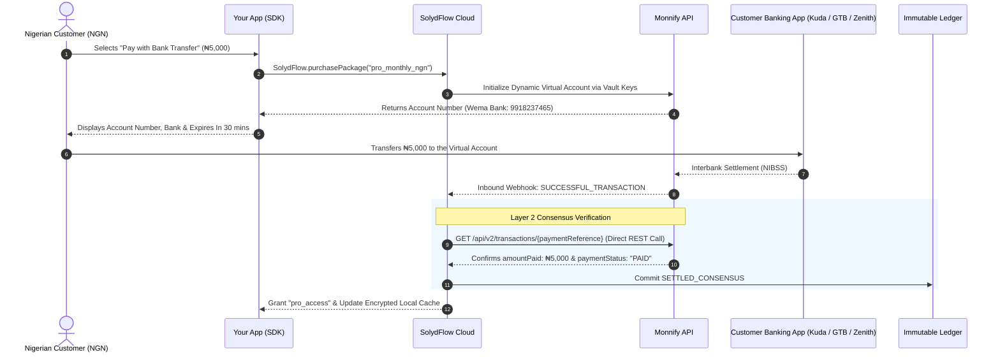

import Tabs from '@theme/Tabs';
import TabItem from '@theme/TabItem';

# Connecting Monnify

Connect your Monnify account to process Nigerian payments via **Dynamic Virtual Accounts (DVA)**, direct bank transfers, and local debit cards (`NGN`).

By routing Nigerian transfers through Monnify and SolydFlow, you bypass high card decline rates and let customers pay via instant bank transfer while the **Consensus Engine** and **Sweeper** verify settlements automatically.



---

## Why Virtual Accounts Outperform Cards in Nigeria

In Nigeria, traditional card checkouts often suffer from high failure rates due to bank 3D-Secure timeouts, daily spending limits, and network dropouts:

* **Card Failure Rate:** Up to **25% – 35%** during peak banking hours.
* **Monnify Virtual Account Success Rate:** Over **96%** completion.

When configured in SolydFlow's **Smart Payment Router**, Nigerian customers choosing bank transfer receive a temporary dedicated account number generated on the fly. As soon as the transfer clears, access unlocks instantly.

---

## Step 1: Add Monnify Credentials to the Vault

SolydFlow requires your Monnify credentials to generate virtual accounts and verify incoming settlements.

1. Log in to your [Monnify Dashboard](https://app.monnify.com).
2. Navigate to **Settings → API Keys & Webhooks**.
3. Copy your:
   * **API Key**
   * **Secret Key**
   * **Contract Code**
4. Open the [SolydFlow Console](https://console.solydflow.com).
5. Navigate to **Project Settings → API Credentials Vault**.
6. Expand the **Monnify** section, paste your credentials for Test and Live, and click **Save Encrypted Configuration**.

:::info{title="AES-256-GCM Encryption"}
All gateway credentials stored in the SolydFlow Vault are encrypted using hardware-backed AES-256-GCM. Secret keys are never exposed to client applications.
:::

---

## Step 2: Configure the Inbound Webhook

Monnify must notify SolydFlow when a customer completes an interbank transfer.

1. In the SolydFlow Console, navigate to **Project Settings → Inbound Gateway Webhook Configurations**.
2. Copy your unique Monnify Inbound Webhook URL:
   ```text
   https://api.solydflow.com/api/v1/webhook/monnify/{your_solydflow_api_key}
   ```
3. In your Monnify Dashboard, go to **Settings → API Keys & Webhooks**.
4. Paste the URL into the **Webhook URL** field.
5. Click **Save Changes**.

---

## How SolydFlow Secures Monnify Transactions

Standard integrations can be vulnerable to partial amount fraud (e.g., transferring ₦500 instead of ₦5,000 to trigger a generic success webhook).

SolydFlow’s **Consensus Engine** prevents this:
1. Intercepts the `SUCCESSFUL_TRANSACTION` webhook.
2. Queries Monnify's transaction status endpoint (`GET /api/v2/transactions/{paymentReference}`) directly.
3. Compares the `amountPaid` returned by Monnify against the package's expected `amountMinor`.
4. Only when the full price is confirmed does SolydFlow commit a `SETTLED_CONSENSUS` event to the **Immutable Ledger**.
5. Entitlements are unlocked locally on the user's device.

---

## Delayed NIBSS Settlement Handling

During high network congestion, interbank transfers may take 5 to 15 minutes to clear through the Nigerian Inter-Bank Settlement System (NIBSS):

```text
Customer sends ₦5,000 via Zenith Mobile App
    ↓
Closes your app while NIBSS clears the transfer
    ↓
Monnify receives funds 10 minutes later and fires webhook
    ↓
SolydFlow Consensus Engine verifies transaction and updates customer profile
    ↓
Customer opens your app: "pro_access" is unlocked immediately from cache ✅
```

---

## Sandbox Testing

When testing with your `sf_pk_test_...` key:
1. Initialize the checkout and select **Pay with Bank Transfer**.
2. Copy the test Virtual Account Number displayed on the modal.
3. Log in to the Monnify Sandbox Dashboard and use the **Simulate Transfer** tool to simulate a successful payment for that account number.
4. Verify that the SDK automatically transitions state to `SETTLED_CONSENSUS` and unlocks the entitlement.

---

## Related Documentation

* **[Connecting Paystack (Cards & USSD) →](./paystack.md)**
* **[Connecting Flutterwave (Pan-Africa) →](./flutterwave.md)**
* **[Smart Payment Routing →](../enforce/smart-routing.md)**
* **[Truth & Consensus Engine →](../truth/consensus-engine.md)**

