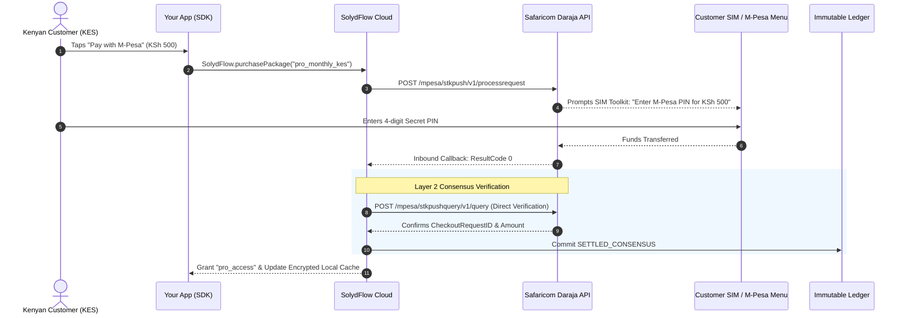

import Tabs from '@theme/Tabs';
import TabItem from '@theme/TabItem';

# Connecting M-Pesa (Daraja)

Connect your Safaricom Daraja account to process native **M-Pesa STK Push (Lipa Na M-Pesa Online)** payments for Kenyan and East African users (`KES`).

By routing M-Pesa through SolydFlow, you eliminate the need to build custom callback listeners or poll Daraja's query APIs manually. SolydFlow handles STK dispatch, handles delayed network PIN entries, and enforces entitlements automatically.



---

## Step 1: Add Daraja Credentials to the Vault

SolydFlow requires your Safaricom Daraja API credentials to initiate STK pushes and query transaction outcomes.

1. Log in to the [Safaricom Daraja Portal](https://developer.safaricom.co.ke).
2. Open your App and locate your **Lipa Na M-Pesa Online** credentials.
3. Open the [SolydFlow Console](https://console.solydflow.com).
4. Navigate to **Project Settings → API Credentials Vault**.
5. Expand the **M-Pesa** section and configure:
   * **Consumer Key:** `x892bc...`
   * **Consumer Secret:** `1029384bc...`
   * **Business ShortCode:** Your Paybill or Till Number (e.g., `174379` for sandbox)
   * **PassKey:** Your 64-character Lipa Na M-Pesa Online PassKey
6. Click **Save Encrypted Configuration**.

:::info{title="AES-256-GCM Vault Security"}
All credentials stored in the SolydFlow Vault are encrypted using hardware-backed AES-256-GCM. Secret keys and passkeys are never exposed to client applications.
:::

---

## Step 2: Configure the Inbound Callback URL

Safaricom must notify SolydFlow when a customer completes their PIN authorization on their phone.

1. In the SolydFlow Console, navigate to **Project Settings → Inbound Gateway Webhook Configurations**.
2. Copy your unique M-Pesa Inbound Callback URL:
   ```text
   https://api.solydflow.com/api/v1/webhook/mpesa/{your_solydflow_api_key}
   ```
3. Paste this URL into your Daraja application's **Callback URL** configuration.

---

## The Critical Phone Number Requirement

For Safaricom to trigger an STK push prompt, the customer's phone number **must be passed in international E.164 format** without the leading `0` or spaces:

* ✅ **Valid:** `+254712345678` or `254712345678`
* ❌ **Invalid:** `0712345678` or `712345678`

<Tabs>
<TabItem value="flutter" label="Flutter" default>

```dart title="lib/main.dart"
// Always pass formatted phone number during configure
await SolydFlow.configure(
  apiKey: "sf_pk_live_44019283bc918237fa",
  userID: "usr_991823",
  userEmail: "customer@example.ke",
  userPhone: "+254712345678", // Enables automatic STK push prompt
);
```

</TabItem>
<TabItem value="javascript" label="JavaScript / TypeScript (Web)">

```typescript title="src/checkout.ts"
import { SolydFlow } from "solydflow-js";

async function buyWithMpesa(packageId: string) {
  // Triggers M-Pesa STK push redirect / modal
  await SolydFlow.purchasePackage(
    packageId,
    "+254712345678" // Customer M-Pesa phone number
  );
}
```

</TabItem>
</Tabs>

---

## Daraja Result Code Mapping

SolydFlow normalizes Safaricom result codes into unified transaction states:

| Daraja `ResultCode` | Daraja Description | SolydFlow Normalized State | Entitlement Access |
| :--- | :--- | :--- | :--- |
| **`0`** | The service request is processed successfully. | **`SETTLED_CONSENSUS`** | **Unlocked ✅** |
| **`1032`** | Request cancelled by user (User pressed Cancel on PIN prompt). | **`FAILED_DECLINED`** | Locked 🔒 |
| **`1`** | The balance is insufficient for the transaction. | **`FAILED_DECLINED`** | Locked 🔒 |
| **`2001`** | The initiator entered the wrong PIN. | **`FAILED_DECLINED`** | Locked 🔒 |
| **`1037`** | DS timeout / No response from handset. | **`UNRESOLVED` ➔ `RECOVERING`** | Evaluated by Sweeper ⏳ |

---

## How SolydFlow Handles Slow Telco Callbacks

Kenyan users often experience a 30 to 90-second delay between entering their PIN and Safaricom delivering the callback:

1. When the checkout initializes, SolydFlow records the transaction as `PENDING_CHALLENGE`.
2. The user sees a clear status: *"Please enter your M-Pesa PIN on your phone"*.
3. If the user closes the app immediately after entering their PIN, the **SolydFlow Sweeper** uses the `CheckoutRequestID` to query the Daraja API in the background.
4. When Daraja confirms settlement, access is updated in the cloud and synced to the device cache on next launch.

---

## Sandbox Testing Matrix

When developing with your `sf_pk_test_...` key, use Daraja sandbox credentials:

* **ShortCode:** `174379`
* **Test MSISDN:** `254708374149` (or any registered Daraja sandbox tester phone number)
* **Simulator PIN:** Enter any 4 digits in the Daraja simulator.

---

## Related Documentation

* **[Connecting Paystack (Pan-Africa) →](./paystack.md)**
* **[Connecting Flutterwave (Pan-Africa) →](./flutterwave.md)**
* **[Smart Payment Routing →](../enforce/smart-routing.md)**
* **[Truth & Consensus Engine →](../truth/consensus-engine.md)**

