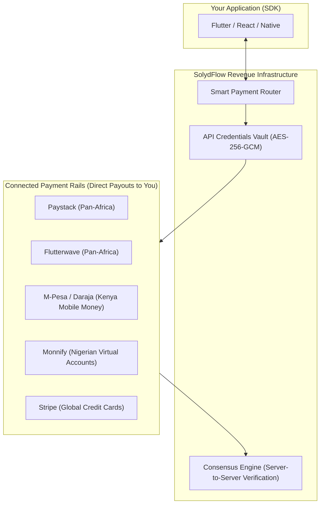

# Payment Providers Overview

SolydFlow acts as an intelligent orchestration and consensus layer above your payment providers. 

Instead of writing bespoke gateway integrations, handling divergent webhook schemas, and maintaining custom retry queues for every app, you connect your merchant accounts to SolydFlow using a secure **Bring Your Own Keys (BYOK)** model.



---

## Supported Provider Compatibility Matrix

| Provider | Primary Markets | Supported Payment Methods | Status |
| :--- | :--- | :--- | :--- |
| **[Paystack](./paystack.md)** | Nigeria, Ghana, South Africa, Kenya | Local Cards, USSD, Direct Bank Transfer, Apple Pay | **Production Ready** |
| **[Flutterwave](./flutterwave.md)** | Pan-Africa (30+ countries) | Cards, Mobile Money (MTN/Airtel/Telecel), Barter | **Production Ready** |
| **[Stripe](./stripe.md)** | Global (US, EU, UK, CA, AU) | International Cards, Apple Pay, Google Pay, SEPA | **Production Ready** |
| **[M-Pesa / Daraja](./mpesa.md)** | Kenya, Tanzania | **M-Pesa STK Push**, Paybill, Buy Goods | **Production Ready** |
| **[Monnify](./monnify.md)** | Nigeria | Reserved Virtual Accounts, Dynamic Accounts | **Production Ready** |
| **[Apple In-App Purchases](./apple.md)** | Global (iOS App Store) | StoreKit 2 Subscriptions & In-App Purchases | *Testing / Beta* |
| **[Google Play Billing](./google-play.md)** | Global (Google Play Store) | Google Play Billing Subscriptions | *Testing / Beta* |

---

## The Bring Your Own Keys (BYOK) Model

SolydFlow does **not** process funds through intermediary accounts:

```text
┌───────────────────────────────────────┬────────────────────────────────────────────────────────┐
│ Ownership Principle                   │ How It Works in SolydFlow                              │
├───────────────────────────────────────┼────────────────────────────────────────────────────────┤
│ 1. Direct Merchant Ownership          │ Funds settle directly from Paystack/Stripe into your bank.│
├───────────────────────────────────────┼────────────────────────────────────────────────────────┤
│ 2. Zero Platform Lock-in              │ Your customer records and gateway tokens belong to you.│
├───────────────────────────────────────┼────────────────────────────────────────────────────────┤
│ 3. Hardware-Grade Encryption          │ Gateway keys are encrypted at rest via AES-256-GCM.    │
└───────────────────────────────────────┴────────────────────────────────────────────────────────┘
```

---

## Inbound Gateway Webhook Architecture

When connecting providers, SolydFlow provisions a dedicated, cryptographically isolated inbound webhook endpoint for your project:

```text
https://api.solydflow.com/api/v1/webhook/{provider}/{your_solydflow_api_key}
```

### Why Inbound Webhooks Are Verified Server-to-Server
Standard integrations blindly trust incoming webhook JSON bodies. SolydFlow’s **Consensus Engine** prevents spoofing:
1. Intercepts the provider webhook.
2. Temporarily holds entitlement activation.
3. Queries the provider's authoritative REST verification API directly using your encrypted secret key.
4. Verifies amount, currency, and reference match before writing a `SETTLED_CONSENSUS` record to your Immutable Ledger.

---

## Provider Integration Guides

Select a provider to view step-by-step API Vault setup and webhook configuration:

<div className="row">
  <div className="col col--6">
    <div className="card padding--md margin-bottom--md">
      <h3>🇳🇬 🇬🇭 🇿🇦 Paystack</h3>
      <p>Pan-African cards, USSD, bank transfers, and Apple Pay.</p>
      <a className="button button--secondary button--block" href="/payment-providers/paystack">Setup Paystack →</a>
    </div>
  </div>
  <div className="col col--6">
    <div className="card padding--md margin-bottom--md">
      <h3>🌍 Flutterwave</h3>
      <p>Pan-African card payments and regional mobile money wallets.</p>
      <a className="button button--secondary button--block" href="/payment-providers/flutterwave">Setup Flutterwave →</a>
    </div>
  </div>
  <div className="col col--6">
    <div className="card padding--md margin-bottom--md">
      <h3>🇰🇪 M-Pesa (Daraja)</h3>
      <p>Native Kenyan mobile money STK push prompts.</p>
      <a className="button button--secondary button--block" href="/payment-providers/mpesa">Setup M-Pesa →</a>
    </div>
  </div>
  <div className="col col--6">
    <div className="card padding--md margin-bottom--md">
      <h3>🌐 Stripe</h3>
      <p>Global card payments, 3D-Secure, and multi-currency billing.</p>
      <a className="button button--secondary button--block" href="/payment-providers/stripe">Setup Stripe →</a>
    </div>
  </div>
  <div className="col col--6">
    <div className="card padding--md margin-bottom--md">
      <h3>🏦 Monnify</h3>
      <p>Nigerian virtual bank accounts and direct debit rails.</p>
      <a className="button button--secondary button--block" href="/payment-providers/monnify">Setup Monnify →</a>
    </div>
  </div>
  <div className="col col--6">
    <div className="card padding--md margin-bottom--md">
      <h3>📱 Mobile App Stores</h3>
      <p>Apple In-App Purchases and Google Play Billing.</p>
      <a className="button button--secondary button--block" href="/payment-providers/apple">Setup Store Billing →</a>
    </div>
  </div>
</div>
