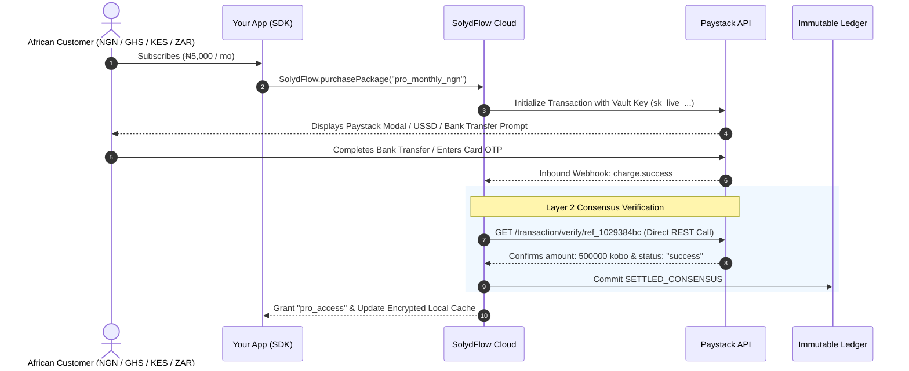

import Tabs from '@theme/Tabs';
import TabItem from '@theme/TabItem';

# Connecting Paystack

Connect your Paystack account to process cards (Visa, Mastercard, Verve), USSD, Direct Bank Transfers, and Apple Pay across African markets (**Nigeria, Ghana, Kenya, and South Africa**).

By integrating Paystack with SolydFlow's **Consensus Engine** and **Sweeper**, you eliminate webhook spoofing, rescue delayed bank transfers, and automate entitlement enforcement.



---

## Step 1: Add Paystack Secret Keys to the Vault

SolydFlow requires your Paystack Secret Keys to initialize transactions and independently verify payments directly with Paystack's API (bypassing client-side spoofing).

1. Log in to your [Paystack Dashboard](https://dashboard.paystack.com).
2. Navigate to **Settings → API Keys & Webhooks**.
3. Copy your **Secret Key** (`sk_test_...` for Sandbox and `sk_live_...` for Production).
4. Open the [SolydFlow Console](https://console.solydflow.com).
5. Go to **Project Settings → API Credentials Vault**.
6. Expand the **Paystack** section, paste both your Test and Live keys, and click **Save Encrypted Configuration**.

:::info{title="AES-256-GCM Encryption"}
All credentials stored in the SolydFlow Vault are encrypted using hardware-backed AES-256-GCM. Secret keys are never exposed to client applications.
:::

---

## Step 2: Configure the Inbound Webhook

Paystack must notify SolydFlow when asynchronous payments (such as USSD or Bank Transfers) settle.

1. In the SolydFlow Console, scroll down to **Inbound Gateway Webhook Configurations**.
2. Copy your unique Paystack Inbound Webhook URL:
   ```text
   https://api.solydflow.com/api/v1/webhook/paystack/{your_solydflow_api_key}
   ```
3. In your Paystack Dashboard, navigate to **Settings → API Keys & Webhooks**.
4. Paste the URL into the **Webhook URL** field (for both Test and Live modes).
5. Click **Save Changes**.

---

## How SolydFlow Secures Paystack Transactions

SolydFlow **never grants access based solely on incoming webhook payloads**.

When Paystack sends a `charge.success` webhook:
1. SolydFlow intercepts the incoming event.
2. Entitlement activation is temporarily held in a pending state.
3. The **Consensus Engine** makes a server-to-server call to Paystack (`GET /transaction/verify/{reference}`) using your encrypted `sk_live_...` key.
4. If the live API response confirms that the amount, currency, and reference match, SolydFlow commits a `SETTLED_CONSENSUS` record to the **Immutable Ledger**.
5. The user's entitlement (e.g., `pro_access`) is immediately granted and synced to their encrypted offline storage.

This prevents:
* **Client-side manipulation:** Faking success callbacks inside the app.
* **Webhook Replay Attacks:** Re-sending previous webhook payloads to gain free access.
* **Partial Amount Fraud:** Paying ₦50 instead of ₦5,000 for a subscription.

---

## Handling Delayed USSD & Bank Transfers

In emerging markets, customers frequently complete payments via bank apps or USSD prompts while their mobile app is closed:

```text
Customer initiates ₦5,000 Bank Transfer via Paystack
    ↓
Switches to banking app to send funds
    ↓
Device kills your app to free memory
    ↓
Paystack registers successful bank transfer
    ↓
SolydFlow Consensus Engine receives webhook & records SETTLED_CONSENSUS
    ↓
Customer re-opens your app: "pro_access" is unlocked instantly from cache ✅
```

---

## Sandbox Testing Matrix

When developing with your `sf_pk_test_...` key, use standard Paystack test cards:

| Test Scenario | Card Number | Expiry | CVV | Pin / OTP | Expected Outcome |
| :--- | :--- | :--- | :--- | :--- | :--- |
| **Successful Payment** | `4084 0841 0000 0000` | Any future date | `408` | `Any 4 digits` / `123456` | `SETTLED_CONSENSUS` (Granted) |
| **Mastercard Test** | `5123 4500 0000 0000` | Any future date | `512` | `Any 4 digits` / `123456` | `SETTLED_CONSENSUS` (Granted) |
| **Declined Card** | `4084 0841 0000 0001` | Any future date | `408` | `Any 4 digits` | `FAILED_DECLINED` (No Access) |
| **Insufficient Funds** | `4084 0841 0000 0002` | Any future date | `408` | `Any 4 digits` | `FAILED_DECLINED` (No Access) |

---

## Related Documentation

* **[Connecting Flutterwave (Pan-Africa) →](./flutterwave.md)**
* **[Connecting M-Pesa (Kenya Mobile Money) →](./mpesa.md)**
* **[Connecting Stripe (Global Cards) →](./stripe.md)**
* **[Smart Payment Routing →](../enforce/smart-routing.md)**
