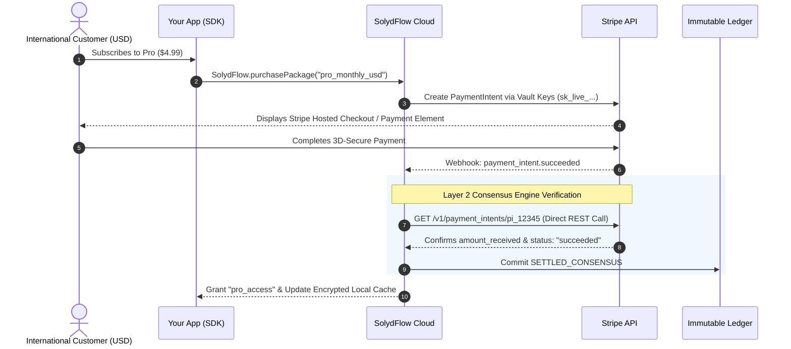

import Tabs from '@theme/Tabs';
import TabItem from '@theme/TabItem';

# Connecting Stripe

Connect your Stripe account to process international credit cards, Apple Pay, Google Pay, and SEPA debits across global markets (USD, EUR, GBP, CAD).

By integrating Stripe with SolydFlow's **Consensus Engine** and **Sweeper**, you eliminate webhook spoofing, resolve state mismatches, and automate subscription recovery.



---

## Step 1: Add Stripe Secret Keys to the Vault

SolydFlow utilizes your Stripe Secret Keys to initialize PaymentIntents and independently verify transaction status directly via the Stripe REST API.

1. Log in to your [Stripe Dashboard](https://dashboard.stripe.com).
2. Navigate to **Developers → API Keys**.
3. Copy your **Secret Key** (`sk_test_...` for Sandbox and `sk_live_...` for Production).
4. Open the [SolydFlow Console](https://console.solydflow.com).
5. Navigate to **Project Settings → API Credentials Vault**.
6. Expand the **Stripe** section, paste both your Test and Live keys, and click **Save Encrypted Configuration**.

:::info{title="AES-256-GCM Encryption"}
All gateway credentials stored in the SolydFlow Vault are encrypted at rest using hardware-backed AES-256-GCM. Secret keys are never exposed to client applications.
:::

---

## Step 2: Configure the Inbound Stripe Webhook

Stripe must notify SolydFlow when asynchronous payment activity occurs.

1. In the SolydFlow Console, navigate to **Project Settings → Inbound Gateway Webhook Configurations**.
2. Copy your unique Stripe Inbound Webhook URL:
   ```text
   https://api.solydflow.com/api/v1/webhook/stripe/{your_solydflow_api_key}
   ```
3. In your Stripe Dashboard, go to **Developers → Webhooks → Add Endpoint**.
4. Paste the SolydFlow Webhook URL into the **Endpoint URL** field.
5. Under **Select events to listen to**, select:
   * `payment_intent.succeeded`
   * `payment_intent.payment_failed`
   * `charge.refunded`
   * `charge.dispute.created`
6. Click **Add Endpoint**.

---

## How SolydFlow Secures Stripe Transactions

Unlike standard integrations, SolydFlow **never grants access based solely on incoming webhook payloads**.

When Stripe dispatches a webhook:
1. SolydFlow intercepts the incoming `payment_intent.succeeded` payload.
2. Entitlement activation is temporarily paused.
3. The **Consensus Engine** makes an authenticated REST API call to Stripe (`GET /v1/payment_intents/{id}`) using your encrypted `sk_live_...` key.
4. If the live API confirms that `amount_received`, `currency`, and `status: succeeded` match, SolydFlow commits a `SETTLED_CONSENSUS` record to your **Immutable Ledger**.
5. The user's entitlement (e.g. `pro_access`) is instantly unlocked.

This completely eliminates **Webhook Replay Attacks** and false payment confirmations.

---

## Refunds & Dispute Handling

When a customer initiates a chargeback or you issue a refund in Stripe:
1. Stripe dispatches `charge.refunded` or `charge.dispute.created`.
2. SolydFlow transitions the transaction state from `SETTLED_CONSENSUS` to **`REVOKED_REFUND`**.
3. The customer's entitlement is revoked across all devices, and SolydFlow fires a signed `subscription_revoked` webhook to your backend server.

---

## Sandbox Testing Matrix

When developing with your `sf_pk_test_...` key, use standard Stripe test cards:

| Test Scenario | Card Number | Expiry | CVC | Expected SolydFlow Outcome |
| :--- | :--- | :--- | :--- | :--- |
| **Successful Payment** | `4242 •••• •••• 4242` | Any future date | `123` | `SETTLED_CONSENSUS` (Entitlement Granted) |
| **3D-Secure Challenge**| `4000 •••• •••• 3063` | Any future date | `123` | Prompts 3DS modal ➔ `SETTLED_CONSENSUS` |
| **Card Declined** | `4000 •••• •••• 0002` | Any future date | `123` | `FAILED_DECLINED` (No Entitlement) |
| **Insufficient Funds**| `4000 •••• •••• 0996` | Any future date | `123` | `FAILED_DECLINED` (No Entitlement) |

---

## Related Documentation

* **[Smart Payment Routing →](../enforce/smart-routing.md)**
* **[Truth & Consensus Engine →](../truth/consensus-engine.md)**
* **[Connecting Paystack (Pan-Africa) →](./paystack.md)**
* **[Connecting Flutterwave (Pan-Africa) →](./flutterwave.md)**
