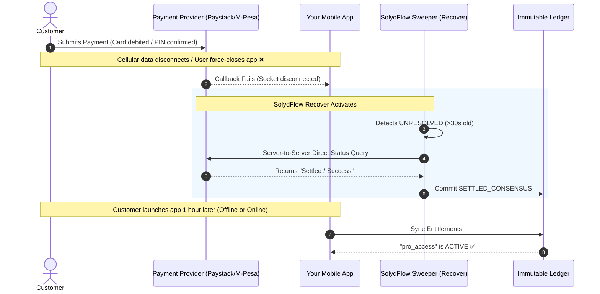

# Recover Overview

**SolydFlow Recover** is the automated resilience engine designed to eliminate revenue leakage caused by network drops, dropped sockets, delayed USSD prompts, and missing gateway webhooks.

In emerging markets, up to **18% of successful payments** fail to unlock customer access immediately because the mobile app closes or cellular data drops before the confirmation callback returns. Recover detects these stranded transactions, establishes truth, and enforces customer access automatically.



---

## The Settlement Gap Problem

Standard payment architectures assume a linear, uninterrupted connection:

```text
[Ideal Flow]:
Checkout ➔ Payment ➔ Webhook ➔ Entitlement Unlocked ✅

[Emerging Market Reality]:
Checkout ➔ Bank Debits User ➔ Cellular Timeout ➔ Missing Webhook ➔ User Locked Out ❌
```

Without an automated recovery layer:
1. The customer gets debited by their bank.
2. Your app keeps features locked because no callback was received.
3. The customer files a chargeback or angry support ticket, assuming they were scammed.
4. You lose customer trust and incur support overhead.

**SolydFlow Recover eliminates this gap.**

---

## The 5 Pillars of Recover

| Pillar | Problem Solved | Mechanism |
| :--- | :--- | :--- |
| **[Transaction Recovery](./transaction-recovery.md)** | Pending transactions that stall mid-checkout. | Background re-querying across connected provider APIs. |
| **[Orphaned Transactions](./orphaned-transactions.md)** | Payments completed at the bank while the app was killed. | The Sweeper Engine matches orphaned intents against bank logs. |
| **[Failed Webhooks](./failed-webhooks.md)** | Dropped, timed-out, or blocked inbound gateway webhooks. | Direct REST verification with fallback polling. |
| **[Retries & Jitter](./retries.md)** | Transient provider network timeouts (`504 Gateway Timeout`). | Exponential backoff with randomized jitter. |
| **[Recovery Workflows](./recovery-workflows.md)** | Cross-device re-engagement for abandoned carts. | SMS, email, and WhatsApp recovery triggers. |

---

## How Recover Differs from Recharging

:::warning{title="Recovery Never Recharges the Customer"}

Recovery **never** submits a new charge attempt to a customer's card or triggers a second mobile money PIN prompt.
:::

Instead, Recover verifies the **existing transaction reference**:
* If the user was **already debited**, Recover verifies the settlement and unlocks access immediately.
* If the user **cancelled or was declined**, Recover transitions the transaction state to `FAILED_DECLINED` so the user can cleanly retry.

---

## Real-World Example: The M-Pesa STK Delay

1. A customer initiates an M-Pesa payment for a **KSh 500** subscription.
2. Safaricom sends the SIM toolkit PIN prompt to their handset.
3. The customer receives a phone call, minimizes your app, and enters their PIN 45 seconds later.
4. The operating system kills your mobile app in the background to free memory.
5. Safaricom settles the funds, but the app is closed.
6. **SolydFlow Recover intercepts:** The Sweeper detects the open intent, queries Safaricom Daraja, records `SETTLED_CONSENSUS` in your cloud ledger, and caches `pro_access` so the user has full access the next time they open the app.

---

## Explore Recover Documentation

<div className="row">
  <div className="col col--6">
    <div className="card padding--md margin-bottom--md">
      <h3>🔄 Transaction Recovery</h3>
      <p>How SolydFlow resolves stalled payments and reconciles pending intents.</p>
      <a className="button button--secondary button--block" href="/recover/transaction-recovery">Read Guide →</a>
    </div>
  </div>
  <div className="col col--6">
    <div className="card padding--md margin-bottom--md">
      <h3>🧟 Orphaned Transactions</h3>
      <p>Learn how the Sweeper Engine revives orphaned payments.</p>
      <a className="button button--secondary button--block" href="/recover/orphaned-transactions">Read Guide →</a>
    </div>
  </div>
  <div className="col col--6">
    <div className="card padding--md margin-bottom--md">
      <h3>📬 Failed Webhooks</h3>
      <p>Handling dropped gateway notifications without losing revenue.</p>
      <a className="button button--secondary button--block" href="/recover/failed-webhooks">Read Guide →</a>
    </div>
  </div>
  <div className="col col--6">
    <div className="card padding--md margin-bottom--md">
      <h3>🔁 Retries & Backoff</h3>
      <p>Exponential backoff strategies for provider API rate limits and timeouts.</p>
      <a className="button button--secondary button--block" href="/recover/retries">Read Guide →</a>
    </div>
  </div>
</div>
